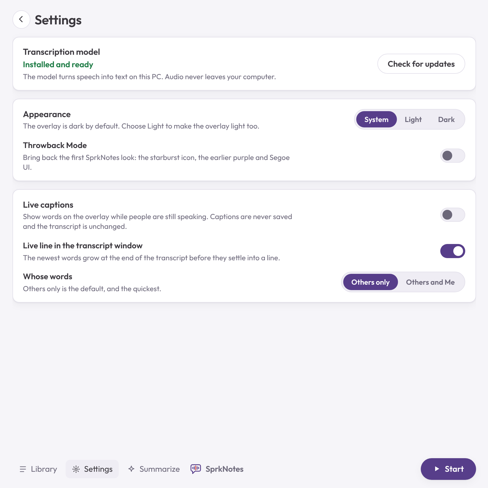

<p align="center"></p>

# SprkNotes

On-device app for Windows (x64 and ARM64), with a native Linux build, that **transcribes your microphone and the system audio together, live**, into crash-safe Markdown files. Audio is processed in memory and never written to disk. Nothing leaves the machine. Built for a HIPAA-regulated company.

> [!IMPORTANT]
> **IT admins: start with the [SprkNotes deployment form](https://conniptionfit.github.io/SprkNotes/).**
> Choose which settings to lock or pre-set and it writes two PowerShell scripts for you: a **lock script** to run as SYSTEM (registry policy, a locked-down policy file, or both) and a **per-user install script** with your starting values baked in, ready for NinjaOne, Intune or any RMM. It runs entirely in your browser and sends nothing anywhere. Step-by-step guide: [Deployment](docs/deployment.md#admin-deployment-form).


*Screenshots in this repo use synthetic text only. They come from the UI running against its built-in mock (`scripts/screenshots.mjs`), in light and dark.*

<table>
<tr>
<td></td>
<td></td>
</tr>
</table>


More in [Features and usage](docs/features.md) and the [user guide](docs/user-guide.md).

## Install (Windows)
Open PowerShell (no admin needed) and run:
```powershell
irm https://raw.githubusercontent.com/ConniptionFit/SprkNotes/main/install.ps1 | iex
```
It installs for you only, in `%LocalAppData%\Programs\SprkNotes`, adds **SprkNotes** to the Start menu, and picks the right build for x64 or ARM64. Then open it and press **Download model** in Settings. Remove it any time with Settings, Apps (transcripts are kept).

- **Updates:** SprkNotes checks the repository's releases and tells you when a newer build exists. Settings lets you pick the channel: **Stable** (default), **Beta** or **Alpha** for early builds.
- **Early builds:** `& ([scriptblock]::Create((irm https://raw.githubusercontent.com/ConniptionFit/SprkNotes/main/install.ps1))) -Channel beta`
- **Managed installs for a team or company:** use the [deployment form](https://conniptionfit.github.io/SprkNotes/) to build the lock and install scripts, then follow [Deployment](docs/deployment.md#admin-deployment-form). Whole-PC installs, locked channel and source, forced or disabled updates and the silent update task are in [Deployment](docs/deployment.md#updates-channels-and-locking).
- Other ways (portable zip, MSI, MSIX, Linux): [Install](docs/install.md).

## What it does
- **Me and Others.** Your mic is labeled `Me`. Everyone you hear through the speakers is `Others`, or a name on a confirmed 1:1 call. When unsure, it says `Others` and never guesses.
- **Crash-safe.** Every committed line is appended to the file and flushed immediately. Kill the app and the transcript is intact.
- **Live captions** on a small floating overlay, word by word as people speak: Others by default, Me optional. Captions are never saved or logged and do not change the transcript. The newest words also grow as a live line at the end of the main window.
- **Library and Summarize.** Browse and search past transcripts, export them, and hand one to the Claude or Microsoft 365 Copilot desktop app for a summary.
- **Overlay and tray.** Minimize the window during a session and a small overlay shows the light, the clock, Pause, Stop and captions. The tray icon mirrors the state and has the same actions.
- **Pause and resume** keep timestamps honest: gaps stay visible.
- **Exports** to Markdown (native), `.txt`, `.json` and `.docx`.
- **Optional calendar names** from classic Outlook (local only), and an **AI handoff** that opens Claude or Microsoft 365 Copilot with a prompt; you press send there.
- **Models are data.** The speech model is a `.sprkmodel` pack chosen by a resolver, never hard-coded. Default: Parakeet TDT 0.6B v2 (NVIDIA, CC BY 4.0). Press **Download model** in Settings to fetch it (and check for a newer one at launch), or use the bundled-model build offline.

## Privacy guarantees
No audio on disk. No network except downloading transcription model packs, which admins can turn off (the only local interfaces are Outlook COM, the Teams local API on `localhost`, and launching Claude/Copilot). No telemetry or crash upload. The only other network use is checking the release page for a newer SprkNotes (admins can turn it off with `UpdateMode=off`). Logs never contain transcript text, subjects or names. Details: [SPEC.md](SPEC.md) section 12 and [CLAUDE.md](CLAUDE.md) hard rules.

## Status
Pre-release (0.0.1, pilot builds are on the Releases page). Built so far: transcript format, writer and recovery, exports, commit buffer and dedupe, session orchestration, model packs, signing and download, calendar selection, handoff plans, call context, admin policy, live captions (ADR-006, ADR-007), the redesigned main window, Settings, overlay and tray, and installers (portable zip, MSI, MSIX). Windows capture (WASAPI) and the desktop shell run on x64; the Snapdragon laptop checks are pending ([manual checks](docs/manual-checks.md)). Linux runs natively (PipeWire or PulseAudio system audio, model download, tray, overlay) with a per-user install script, but no packaged release yet. The Library window (list, search, read, export, folders, rename, move, delete to the Recycle Bin) and Summarize work. Close hides to the tray. Not finished: drag to move in the Library, Teams local API. See [CHANGELOG.md](CHANGELOG.md) and the milestone table in SPEC.md section 14.

## Docs
| Doc | For |
|---|---|
| **[Deployment form](https://conniptionfit.github.io/SprkNotes/)** | **Admins: build the lock and install scripts in your browser** |
| [Features and usage](docs/features.md) | Everything the app does, with screenshots |
| [Install](docs/install.md) | Installing on one PC: portable zip, MSI, MSIX, Linux, models, uninstall |
| [Moving or forking](docs/forking.md) | Moving to another repository (such as a corporate GitHub) or forking an edition |
| [Deployment](docs/deployment.md) | Intune, GPO, SCCM, RMM as SYSTEM, registry policy, updates and channels |
| [Enterprise install research](docs/enterprise-install-research.md) | Installer and update options compared, with recommendations |
| [User guide](docs/user-guide.md) | Using the app |
| [Admin guide](docs/admin-guide.md) | Deploying, policy keys, model runbook |
| [Architecture](docs/architecture.md) | Crates, data flow, extension points |
| [Dev environment](docs/dev-environment.md) | Building and testing |
| [Manual checks](docs/manual-checks.md) | Things that need a person or a laptop |
| [ADRs](docs/adr/) | Decisions |
| [SPEC.md](SPEC.md) | Source of truth |
| [Third-party notices](THIRD_PARTY_NOTICES.md) | Licenses and the Parakeet attribution |

## Build and test (Linux dev host)
```bash
cargo test --workspace
cargo clippy --workspace --all-targets -- -D warnings
cargo fmt --all --check
scripts/check-terms.sh            # terminology gate
cd app/ui && npm ci && npm run check && npm test
```
Cross-compile for Windows with `cargo xwin` (see the dev environment doc). Windows integration tests run in the VM with `scripts/winvm.sh`. To refresh the screenshots, start the UI (`cd app/ui && npx vite --port 1420`) and run `node scripts/screenshots.mjs` (needs Playwright with Chromium).

## Look and feel
The current brand is a speech-bubble-and-waveform icon, the Outfit font and a purple and ink palette. **Settings, Misc, Throwback Mode** brings back the first look (starburst icon, earlier purple, Segoe UI).

## Models and attribution
Transcription uses *Parakeet TDT 0.6B v2 by NVIDIA, licensed under CC BY 4.0*. The interface font is Outfit (SIL OFL 1.1). See [THIRD_PARTY_NOTICES.md](THIRD_PARTY_NOTICES.md).

## License
MIT. See [LICENSE](LICENSE).
