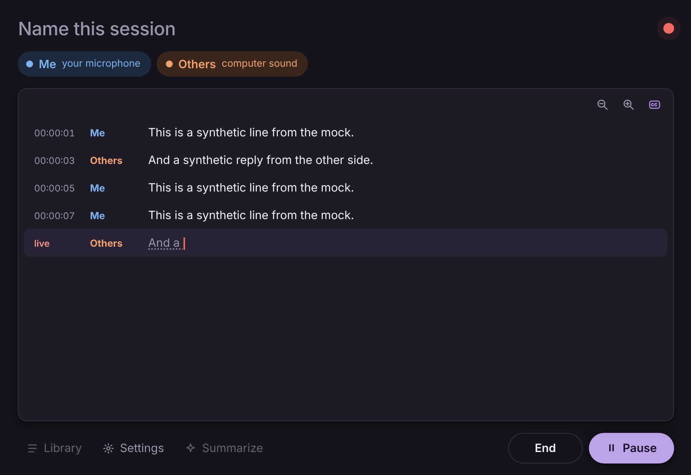
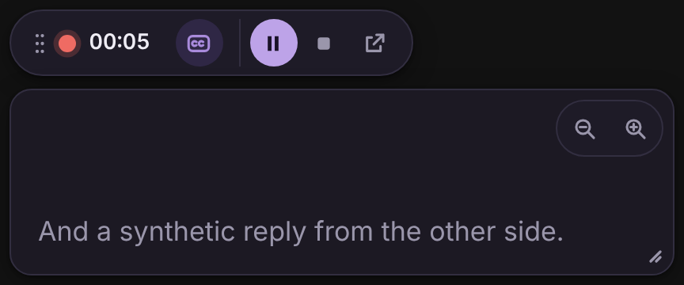

# SprkNotes

On-device app for Windows (x64 and ARM64), with a native Linux build, that **transcribes your microphone and the system audio together, live**, into crash-safe Markdown files. Audio is processed in memory and never written to disk. Nothing leaves the machine. Built for a HIPAA-regulated company.


*Screenshots in this repo use synthetic text only. They come from the UI running against its built-in mock (`scripts/screenshots.mjs`), in light and dark.*

<table>
<tr>
<td></td>
<td></td>
</tr>
</table>



More in the [user guide](docs/user-guide.md).

## What it does
- **Me and Others.** Your mic is labeled `Me`. Everyone you hear through the speakers is `Others`, or a name on a confirmed 1:1 call. When unsure, it says `Others` and never guesses.
- **Crash-safe.** Every committed line is appended to the file and flushed immediately. Kill the app and the transcript is intact.
- **Live captions** on a small floating overlay, word by word as people speak: Others by default, Me optional. Captions are never saved or logged and do not change the transcript. The newest words also grow as a live line at the end of the main window.
- **Overlay and tray.** Minimize the window during a session and a small overlay shows the light, the clock, Pause, Stop and captions. The tray icon mirrors the state and has the same actions.
- **Pause and resume** keep timestamps honest: gaps stay visible.
- **Exports** to Markdown (native), `.txt`, `.json` and `.docx`.
- **Optional calendar names** from classic Outlook (local only), and an **AI handoff** that opens Claude or Microsoft 365 Copilot with a prompt; you press send there.
- **Models are data.** The speech model is a `.sprkmodel` pack chosen by a resolver, never hard-coded. Default: Parakeet TDT 0.6B v2 (NVIDIA, CC BY 4.0). Press **Download model** in Settings to fetch it (and check for a newer one at launch), or use the bundled-model build offline.

## Privacy guarantees
No audio on disk. No network except downloading transcription model packs, which admins can turn off (the only local interfaces are Outlook COM, the Teams local API on `localhost`, and launching Claude/Copilot). No telemetry, app update checks or crash upload. Logs never contain transcript text, subjects or names. Details: [SPEC.md](SPEC.md) section 12 and [CLAUDE.md](CLAUDE.md) hard rules.

## Status
Pre-release (0.0.1, pilot builds are on the Releases page). Built so far: transcript format, writer and recovery, exports, commit buffer and dedupe, session orchestration, model packs, signing and download, calendar selection, handoff plans, call context, admin policy, live captions (ADR-006, ADR-007), the redesigned main window, Settings, overlay and tray, and installers (portable zip, MSI, MSIX). Windows capture (WASAPI) and the desktop shell run on x64; the Snapdragon laptop checks are pending ([manual checks](docs/manual-checks.md)). Linux runs natively (PipeWire or PulseAudio system audio, model download, tray, overlay) but has no packaged release yet. Not finished: library window, Summarize in the UI, hide-to-tray on Close, Teams local API. See [CHANGELOG.md](CHANGELOG.md) and the milestone table in SPEC.md section 14.

## Docs
| Doc | For |
|---|---|
| [Install](docs/install.md) | Installing on one PC: portable zip, MSI, MSIX, Linux, models, uninstall |
| [Deployment](docs/deployment.md) | Intune, GPO, SCCM, RMM as SYSTEM, registry policy |
| [User guide](docs/user-guide.md) | Using the app |
| [Admin guide](docs/admin-guide.md) | Deploying, policy keys, model runbook |
| [Architecture](docs/architecture.md) | Crates, data flow, extension points |
| [Dev environment](docs/dev-environment.md) | Building and testing |
| [Manual checks](docs/manual-checks.md) | Things that need a person or a laptop |
| [ADRs](docs/adr/) | Decisions |
| [SPEC.md](SPEC.md) | Source of truth |
| [Third-party notices](THIRD_PARTY_NOTICES.md) | Licenses and the Parakeet attribution |

## Build and test (Linux dev host)
```bash
cargo test --workspace
cargo clippy --workspace --all-targets -- -D warnings
cargo fmt --all --check
scripts/check-terms.sh            # terminology gate
cd app/ui && npm ci && npm run check && npm test
```
Cross-compile for Windows with `cargo xwin` (see the dev environment doc). Windows integration tests run in the VM with `scripts/winvm.sh`. To refresh the screenshots, start the UI (`cd app/ui && npx vite --port 1420`) and run `node scripts/screenshots.mjs` (needs Playwright with Chromium).

## Models and attribution
Transcription uses *Parakeet TDT 0.6B v2 by NVIDIA, licensed under CC BY 4.0*. See [THIRD_PARTY_NOTICES.md](THIRD_PARTY_NOTICES.md).

## License
MIT. See [LICENSE](LICENSE).
