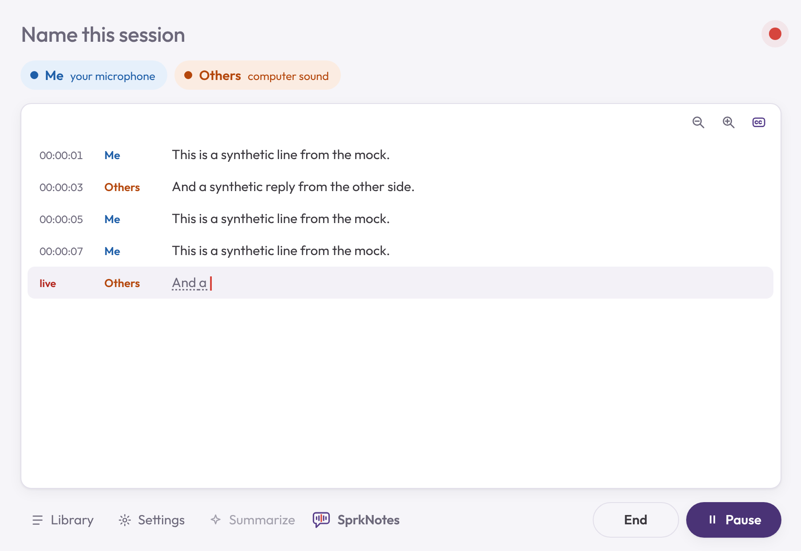

# SprkNotes

On-device Windows app that **transcribes your microphone and the system audio together, live**, into crash-safe Markdown files. Audio is processed in memory and never written to disk. Nothing leaves the machine. Built for a HIPAA-regulated company.



*Screenshots in this repo use synthetic text only.*

## What it does
- **Me and Others.** Your mic is labeled `Me`. Everyone you hear through the speakers is `Others`, or a name on a confirmed 1:1 call. When unsure, it says `Others` and never guesses.
- **Crash-safe.** Every committed line is appended to the file and flushed immediately. Kill the app and the transcript is intact.
- **Pause and resume** keep timestamps honest: gaps stay visible.
- **Exports** to Markdown (native), `.txt`, `.json` and `.docx`.
- **Optional calendar names** from classic Outlook (local only), and an **AI handoff** that opens Claude or Microsoft 365 Copilot with a prompt; you press send there.
- **Models are data.** The speech model is a signed `.sprkmodel` pack chosen by a resolver, never hard-coded. Default: Parakeet TDT 0.6B.

## Privacy guarantees
No audio on disk. No network (the only local interfaces are Outlook COM, the Teams local API on `localhost`, and launching Claude/Copilot). No telemetry, update checks or crash upload. Logs never contain transcript text, subjects or names. Details: [SPEC.md](SPEC.md) section 12 and [CLAUDE.md](CLAUDE.md) hard rules.

## Status
Pre-release (0.0.1). Portable cores are built and tested on Linux: transcript format, writer and recovery, exports, commit buffer and dedupe, session orchestration, model packs and signing, calendar selection, handoff plans, context tracking. The main window UI exists. Windows-only code (WASAPI capture, AEC, Outlook COM, Teams API, Tauri wiring) and packaging are in progress. See [CHANGELOG.md](CHANGELOG.md) and the milestone table in SPEC.md section 14.

## Docs
| Doc | For |
|---|---|
| [Install](docs/install.md) | Installing on one PC: portable zip, MSI, MSIX, models, uninstall |
| [Deployment](docs/deployment.md) | Intune, GPO, SCCM, RMM as SYSTEM, registry policy |
| [User guide](docs/user-guide.md) | Using the app |
| [Admin guide](docs/admin-guide.md) | Deploying, policy keys, model runbook |
| [Architecture](docs/architecture.md) | Crates, data flow, extension points |
| [Dev environment](docs/dev-environment.md) | Building and testing |
| [Manual checks](docs/manual-checks.md) | Things that need a person or a laptop |
| [ADRs](docs/adr/) | Decisions |
| [SPEC.md](SPEC.md) | Source of truth |
| [Third-party notices](THIRD_PARTY_NOTICES.md) | Licenses |

## Build and test (Linux dev host)
```bash
cargo test --workspace
cargo clippy --workspace --all-targets -- -D warnings
cargo fmt --all --check
scripts/check-terms.sh            # terminology gate
cd app/ui && npm ci && npm run check && npm test
```
Cross-compile for Windows with `cargo xwin` (see the dev environment doc). Windows integration tests run in the VM with `scripts/winvm.sh`.

## License
MIT. See [LICENSE](LICENSE).
