# SprkNotes features and usage

A tour of everything SprkNotes does and how to use it, with screenshots. All screenshots use synthetic text, in light and dark. For step-by-step help see the [user guide](user-guide.md); for installing see [install.md](install.md).

**Contents:** [At a glance](#at-a-glance) · [Transcribing](#transcribing) · [Live text](#live-text) · [Overlay and captions](#overlay-and-captions) · [Tray](#tray) · [Library](#library) · [Summarize](#summarize) · [Settings](#settings) · [Models](#models) · [Look](#look) · [Files and privacy](#files-and-privacy) · [Linux](#linux) · [For admins](#for-admins) · [Keyboard and accessibility](#keyboard-and-accessibility)

## At a glance
| Feature | What it does |
|---|---|
| **Me and Others** | Your microphone is `Me`; everything you hear through the speakers is `Others` (a name on a confirmed 1:1 call). When unsure it says `Others`, never a guess. |
| **Live transcript** | Lines appear as people finish speaking, with a live line showing the words in progress. |
| **Crash-safe files** | Every committed line is written and flushed at once. Kill the app and the transcript is intact. |
| **Pause and resume** | Gaps stay visible in the timestamps. |
| **Overlay with live captions** | A small always-on-top controller with word-by-word captions. |
| **Tray icon** | State at a glance and the same actions. |
| **Library** | Browse, search, read, export and organize past transcripts in folders. |
| **Summarize** | Hand a transcript to Claude or Microsoft 365 Copilot. |
| **On-device speech model** | Parakeet TDT 0.6B v2, downloaded once from Settings (or bundled). |
| **No audio on disk, no cloud** | Audio lives in memory only. The only network use is model downloads. |

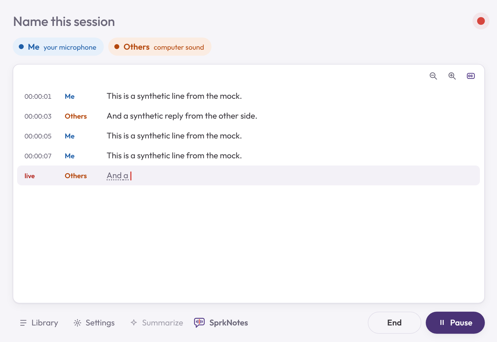

## Transcribing
1. Optionally name the session. Blank means SprkNotes names the file from your calendar, the call or the audio playing, and falls back to `Transcript`.
2. Choose sources: **Me** (your microphone) and **Others** (computer sound).
3. Press **Start**. The light turns red.

| Ready | Named, Me turned off |
|---|---|
| 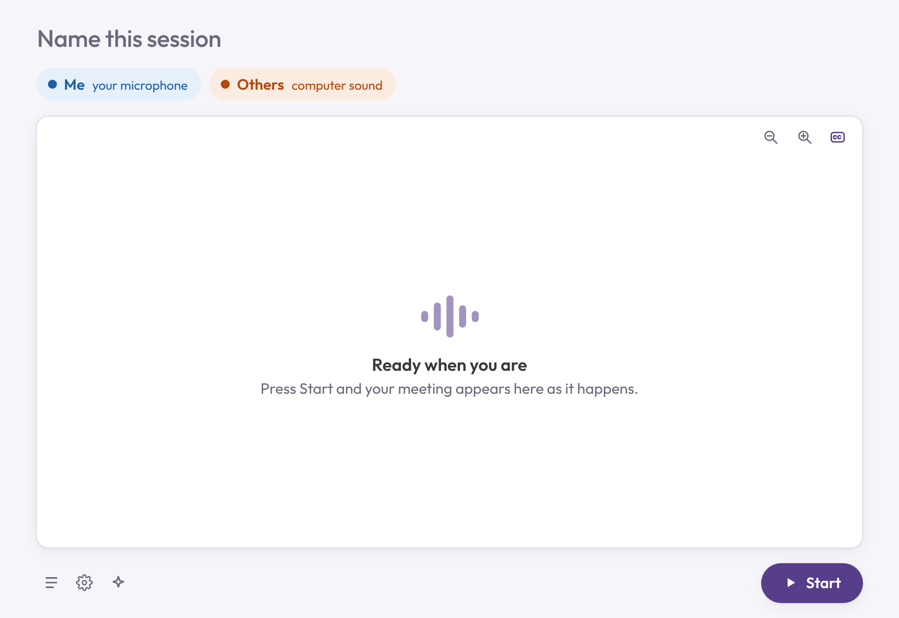 | 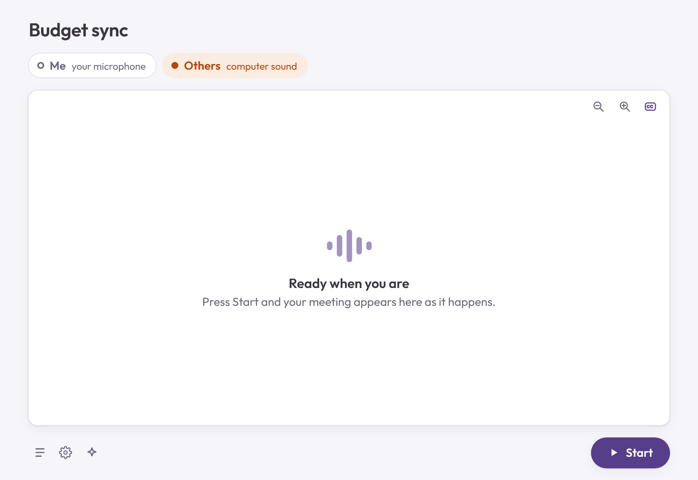 |

While transcribing:
- **Pause** writes a pause line and stops capture; **Resume** continues. **End** finishes the file.
- The light shows the state: green ready, red transcribing, yellow paused.
- **Mark** (or Ctrl+M) flags the moment, and the note box saves a short typed note with the time (Enter). Both are written into the transcript straight away, stand out in the live view and the Library, and reach Summarize and Ask Sprk.
- Turn sources on or off at any time. Source changes (a headset plugged in, a default device change) are written as event lines.

| Transcribing | Paused |
|---|---|
|  | 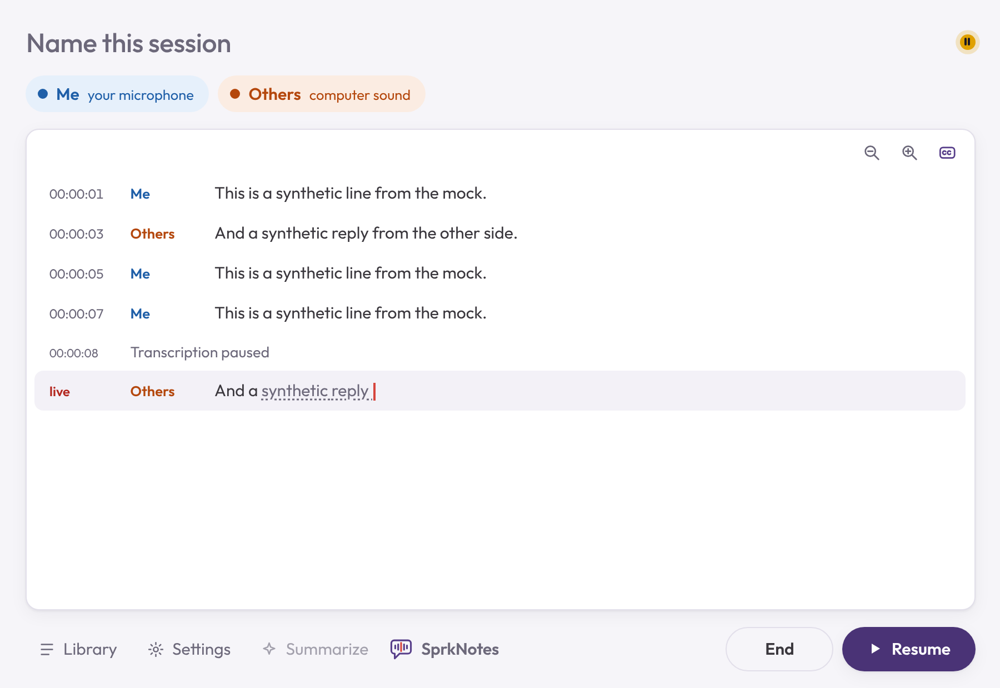 |

Dark mode is the same app:

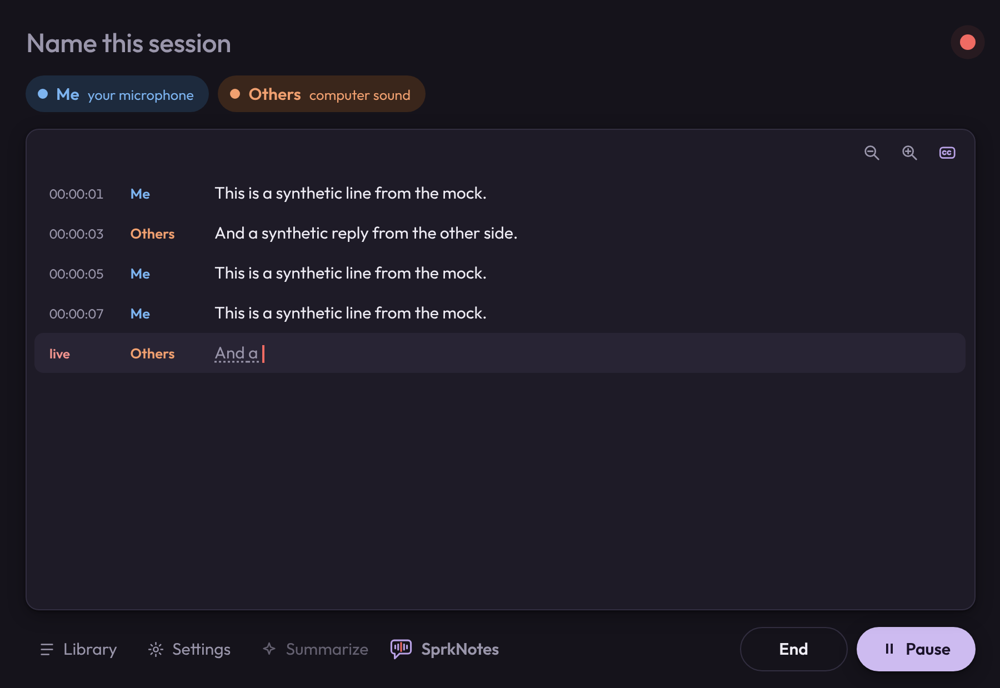

## Live text
The last row, marked **live**, shows the words being spoken right now. Text types out at an even pace, only the last word or two are lighter and may still change, and sentences **lock in** as they finish (or after about 1.5 seconds, or a pause) so they stay put in normal color; the finished line quietly replaces them later. The transcript fills from the bottom: new rows push older ones up. The live line is a preview: never saved, never logged, and the saved transcript comes only from finished sentences. Turn it on or off, choose whose words it shows, and set the **Live text delay** (Fast, Steady or Smoothest: a short wait, under a second on Steady, that lets words settle so fewer change on screen) in [Settings](#settings). The magnifier buttons change the text size.

### Scrolling
The pane follows new lines while you are at the bottom. Scroll up (wheel, touch, PageUp, Home or the scrollbar) to read earlier text: it stops moving, and it only stops when you scroll, never because new text arrived, and a **Return to live** pill counts the new lines. Click it or press **End** to jump back.

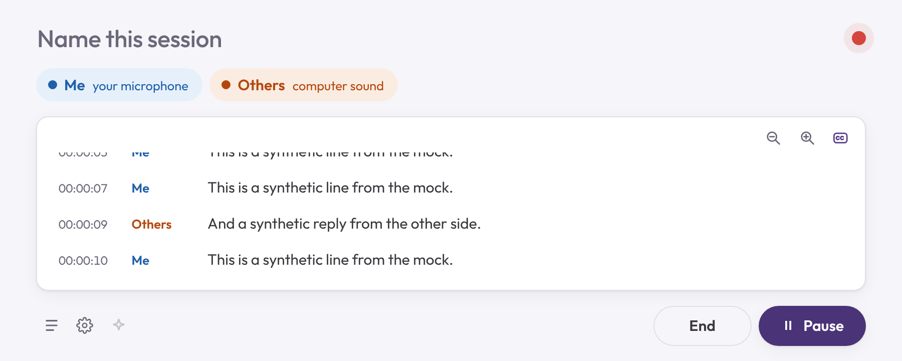

## Overlay and captions
Minimize the window during a session and a small overlay appears, always on top. Without a session nothing appears.

| Ready | Hover for buttons | Paused |
|---|---|---|
| 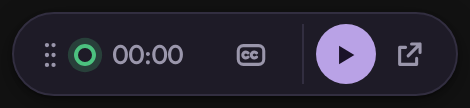 | 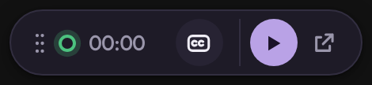 | 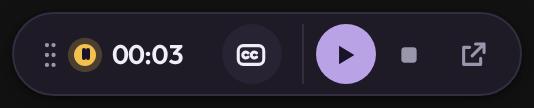 |

- Drag the dotted handle to move it; SprkNotes remembers the spot per screen.
- Always visible: the light, elapsed time and the **captions** button. Hover or tab to it to reveal **Start / Pause / Resume**, **Stop** and **Open SprkNotes**.
- Dark by default. Choose Light in Settings to make it light.

### Live captions
Press the captions button for a caption bar with the newest lines and the line being spoken at the bottom. Others only by default; Settings can add Me.

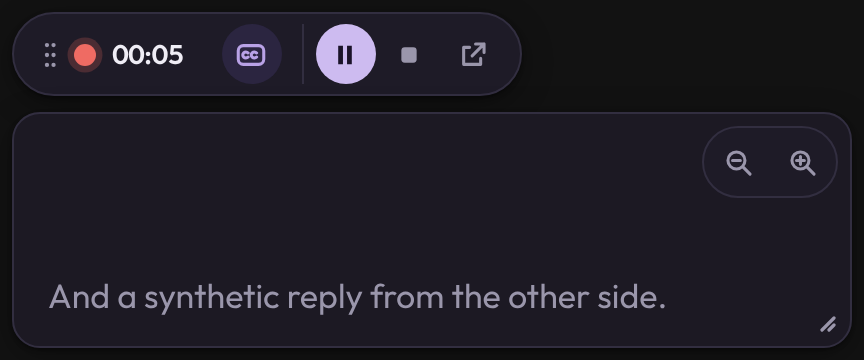

| Others and Me | Large text | Light |
|---|---|---|
| 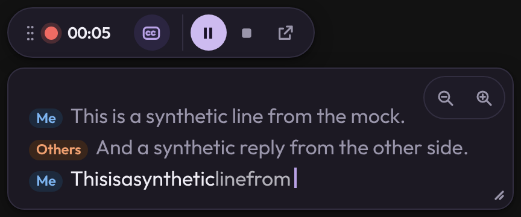 | 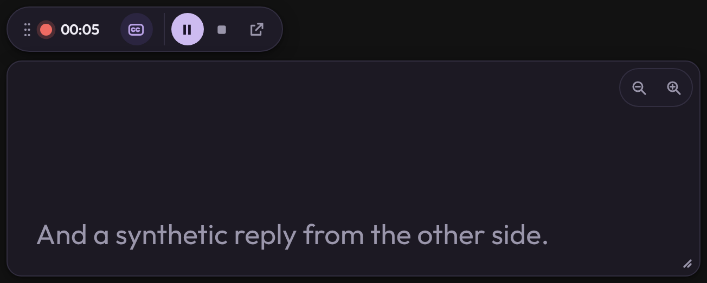 |  |

- Hover for the magnifier buttons; drag the corner handle (or use the arrow keys, Shift for fine steps) to resize. Size and text size are remembered.
- In the lower half of the screen the bar opens **above** the overlay so it never goes off screen:

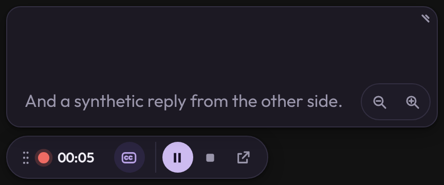

Captions are never saved or logged and never change the transcript. If the PC cannot keep up, captions switch themselves off for the session and transcribing carries on.

## Tray
The tray icon mirrors the state. Click it (or double-click on Windows) to bring the window back. The menu offers **Start**, **Pause**, **Resume**, **End**, **Open SprkNotes** and **Quit**, whichever apply. **Closing the window hides it to the tray** and a running session continues; **Quit** from the tray menu really exits and ends the session first.

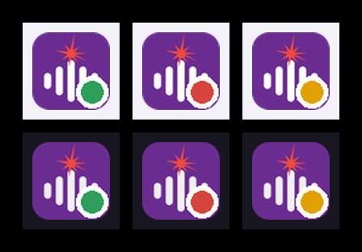

If the desktop has no tray host (some Linux setups), Close minimizes instead so the app is never lost.

## Ask Sprk (optional)
Ask Sprk answers questions about the transcript while it is still going. It is **off until you turn it on** in Settings, runs on this PC at low priority, and never saves or sends anything. Question history lasts only until you close the app.

- **Included once it is on:** Suggest a title, What did I miss? (the last few minutes), Action items (who, and when it is due only if someone said), and a question box. Every answer shows the times of the lines it came from. If the transcript does not say, it says so instead of guessing.
- **More, each off until you choose:** Agenda check, My commitments, Pin a moment, Parking lot, Explain this, Say it again short, Next-meeting prep, Was I asked something?, Summary so far, and Catch-ups (a short note written in the background every 10 minutes). With the overlay, hover it and press Catch me up for a quick recap without opening the app.
- **Size:** Light is the default. Standard is slower and needs more memory. Your organization can limit which size and features are allowed.
- It needs an assistant model installed first (Settings shows when one is missing).

## Library
**Library** lists your transcripts newest first. Search matches names and the words inside transcripts. Open one to read it, then **View in folder**, **Export** (Word, plain text or JSON, saved next to the transcript), **Move** (into a folder), **Rename**, **Delete** (asks first, then moves it to the Recycle Bin) or **Summarize**. The folder picker above the list shows all transcripts, the top of the library or one folder; **New folder** and **Rename folder** sit next to it. The transcript of a session that is still running can't be moved, renamed or deleted until you press End.

| List | Reading |
|---|---|
| 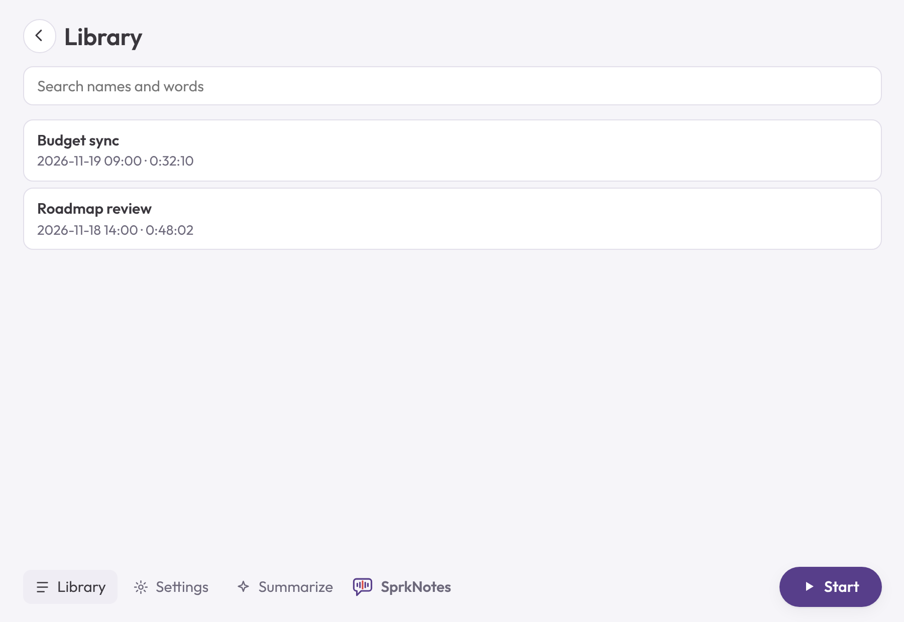 | 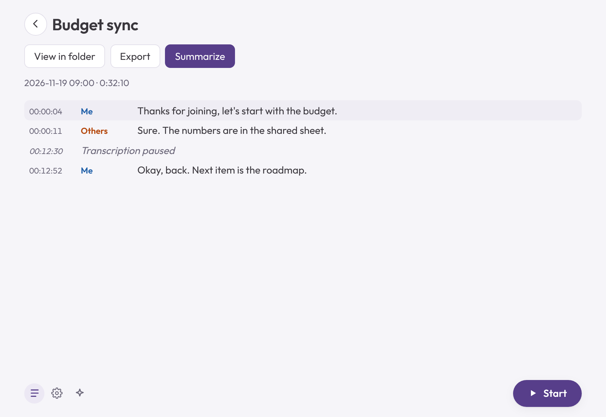 |

Not yet: folders, rename and delete.

## Summarize
**Summarize** hands a transcript to an assistant. SprkNotes sends nothing itself; you review and send inside that app.

| Both apps installed: choose | Neither found |
|---|---|
| 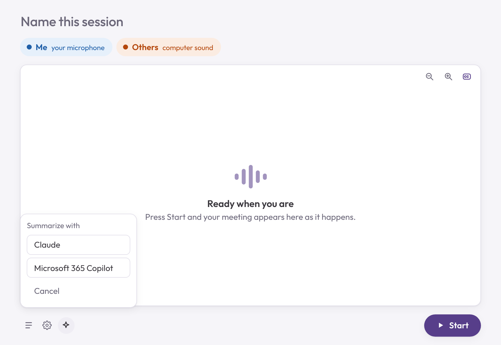 | 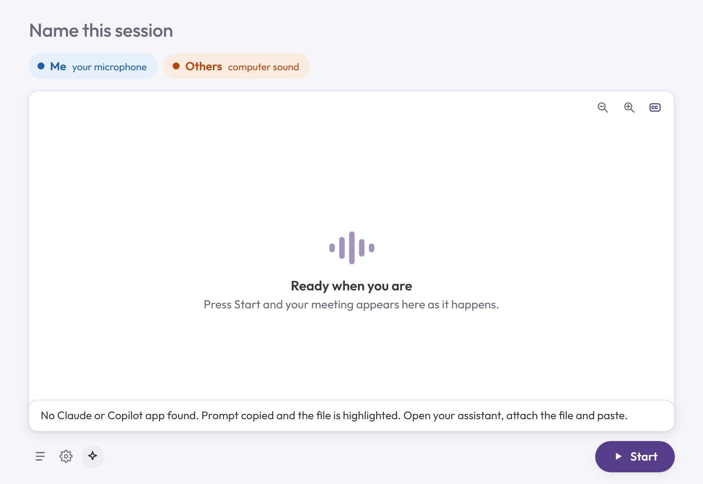 |

With one app installed it opens that one (Claude gets the file; for Copilot the prompt is copied and the file highlighted). With neither, it copies the prompt and shows the file so you can attach it anywhere.

## Settings
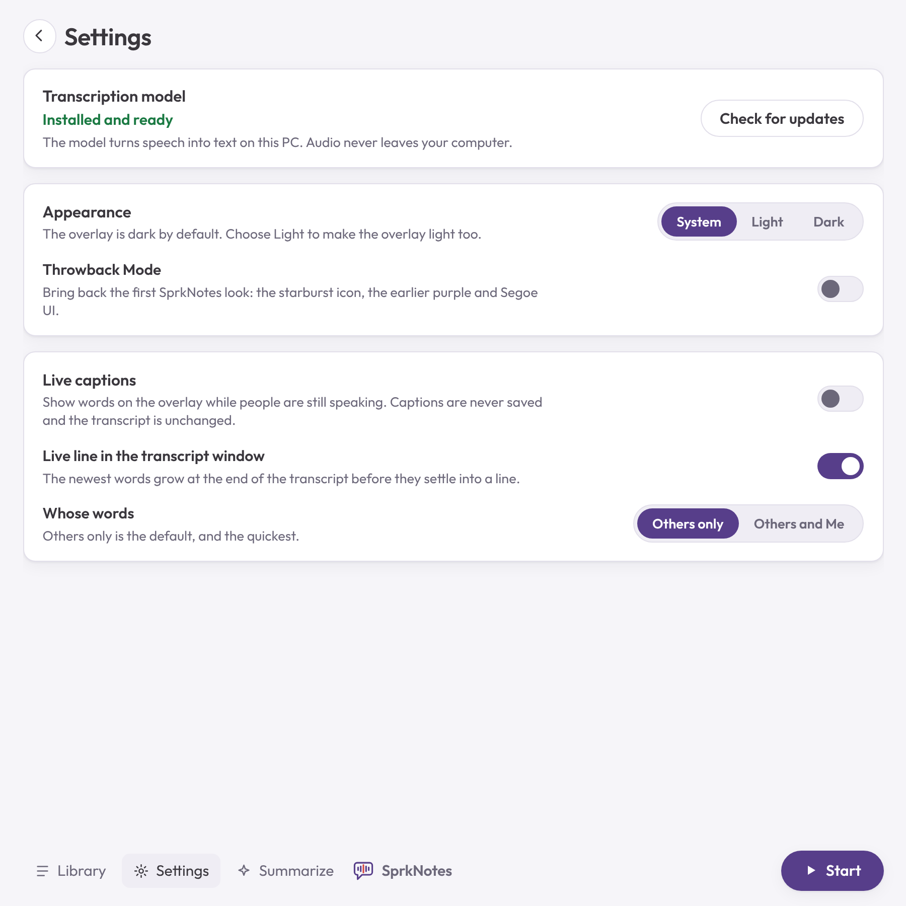

- **Transcription model:** status, **Download model**, **Check for updates**.
- **Appearance:** System, Light or Dark.
- **Misc:** Throwback Mode.
- **Live captions:** captions on the overlay, the live line in the main window, **Live text delay** (Fast, Steady, Smoothest) and whose words (Others only or Others and Me).

Dark: 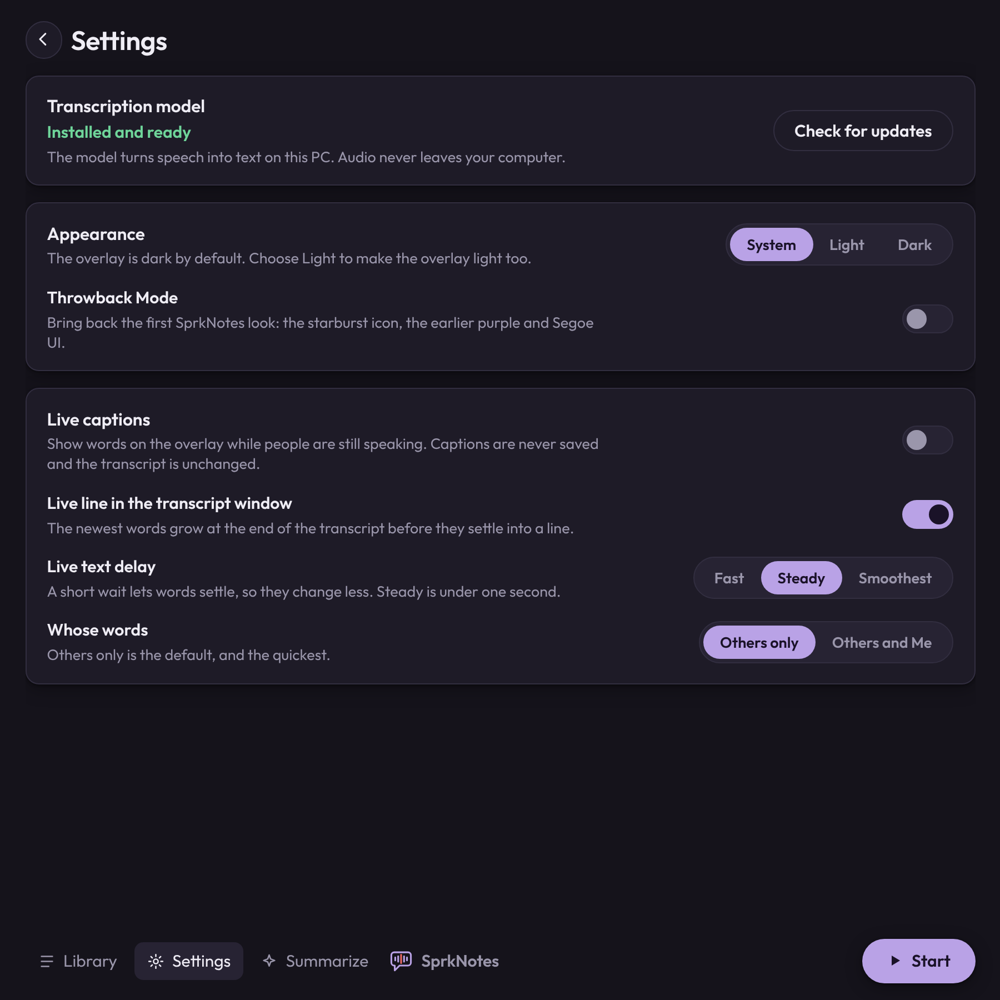

## Models
SprkNotes needs a transcription model. With none installed, the first-run screen offers **Download model**:

| First run | Downloading | Update available | Managed by your organization |
|---|---|---|---|
| 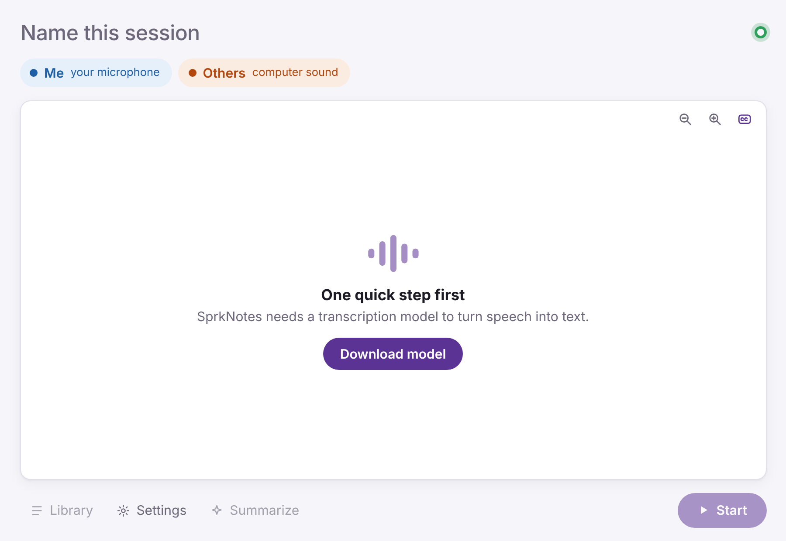 | 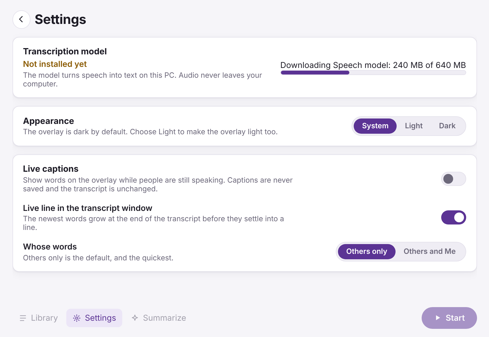 | 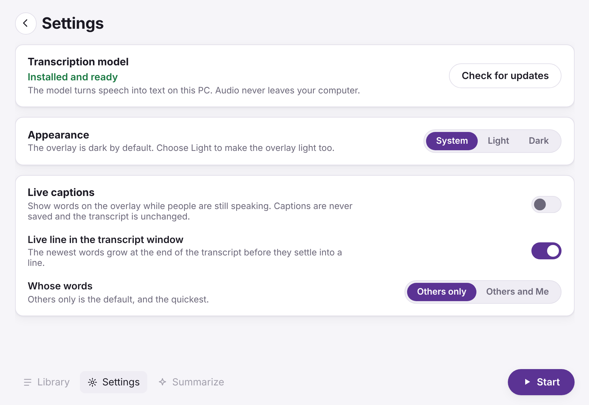 | 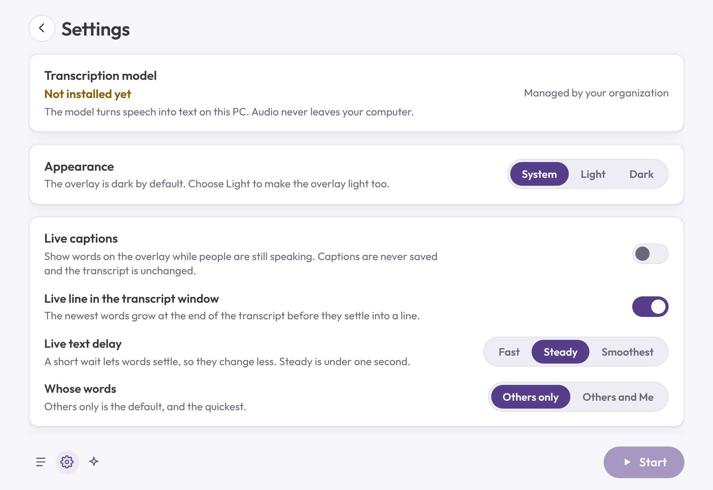 |

Downloads come in parts, are checked against checksums, and are blocked during a session. A quiet check at launch tells you when a newer model exists; it never downloads on its own. Admins can turn this off or point it at an internal mirror (shown as "managed"). Offline, use a bundled-model build or a pack file ([install.md](install.md#models)).

Speech recognition uses *Parakeet TDT 0.6B v2 by NVIDIA, licensed under CC BY 4.0*.

## Look
The current brand is a speech bubble with a waveform, the Outfit font and a purple and ink palette. **Throwback Mode** (Settings, Misc) brings back the first icon, the starburst, on the window, taskbar and tray. Only the icon changes: fonts, colors and layout stay exactly the same, so nothing on the page moves.

## Files and privacy
- Transcripts are Markdown in `Documents\SprkNotes\Transcripts`: `YYYY-MM-DD HHmm <Title>.md`, with a `.jsonl` sidecar. Each line is `` - `HH:MM:SS` **Speaker:** text ``; lines starting with `>` are events (pauses, call changes, audio sources).
- Lines are written in time order even when both sides talk at once, and speech that never pauses (a lecture, a video) is cut and committed steadily instead of stalling for a minute. SprkNotes keeps one second of audio from before speech is detected (the detector reports speech about 0.65 s late), without reaching into the previous line, so the first words of a sentence are not lost.

### After a crash
Every committed line is already on disk, so a crash or power loss loses at most the words not yet committed. On the next start SprkNotes tells you it closed unexpectedly and offers **Open** (goes to the Library) or **Mark finished** (closes the transcript as interrupted).

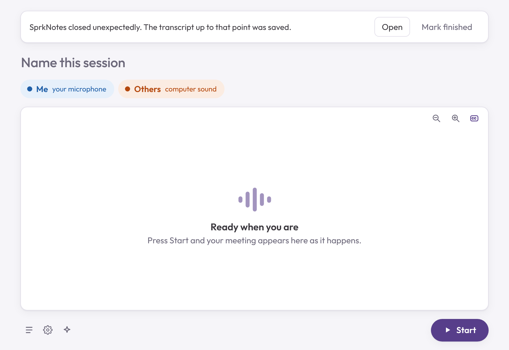

### When something goes wrong
Problems that used to be silent now show a notice:
- **A Start that fails** shows the reason.
- **A line that could not be saved:** "Check that the folder can be written to and has free space."
- **A transcript that could not be closed:** it still holds everything saved so far.
- **No audio is ever written to disk.** No telemetry, crash upload or app update checks. Logs never contain transcript text, subjects or names.
- Optional meeting names come from classic Outlook (local only). Teams call context uses the local API on `localhost`.

## Linux
The same app runs natively on Linux (CachyOS and other desktops): system audio from the default output's monitor via `parec`, an optional tray, and the overlay through XWayland on Wayland. See [install.md](install.md#d-linux-native-build).

## For admins
Deployment through Intune, GPO, SCCM or an RMM, registry policy keys, model runbook and signing are in the [admin guide](admin-guide.md) and [deployment](deployment.md).

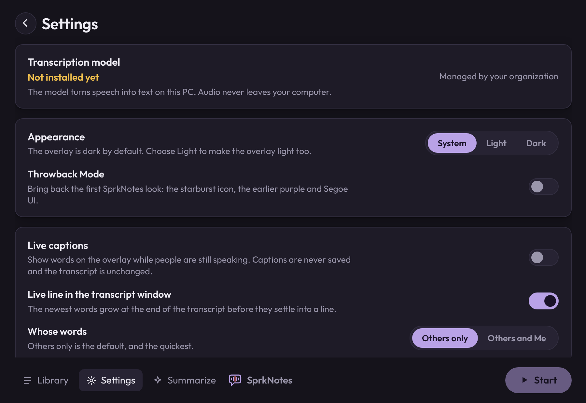

## Keyboard and accessibility
- Everything is reachable by keyboard; the overlay's buttons appear on keyboard focus too. **End** jumps to the live end of the transcript. **Ctrl+M** drops a mark while a session runs. **Esc** hides the overlay's buttons.
- The state is also in the tray tooltip and menu header, not only the light's color. Text sizes are adjustable. New live words appear whole, with no typing animation, when the system asks for reduced motion.
