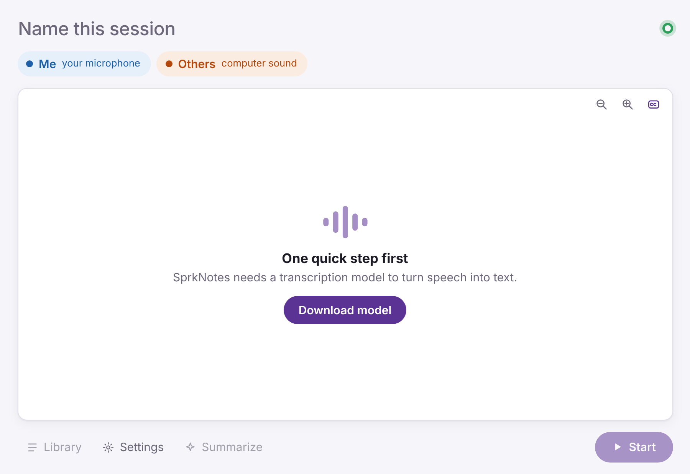

# Installing SprkNotes on one device

Pick the shortest path that fits. All paths install the same build and never touch existing transcripts.

| Path | Admin needed | Certificate | Best for |
|---|---|---|---|
| [Portable zip](#a-standalone-portable-zip) | No | No | Trying it, a single PC, a USB stick |
| [MSI per-user](#b-full-install-msi) | No | No | One person's PC |
| [MSI per-machine](#b-full-install-msi) | Yes | No | Shared PCs, IT-managed installs |
| [MSIX](#c-full-install-msix) | No (after trust is set up) | Yes, trusted by the PC | Intune and managed fleets |
| [Linux](#d-linux-native-build) | No | No | CachyOS, Arch and other desktops; built from source |

For fleets see [deployment.md](deployment.md).

## Quick install (one line, per user)
```powershell
irm https://raw.githubusercontent.com/ConniptionFit/SprkNotes/main/install.ps1 | iex
```
Needs no admin rights. It finds the newest release on your channel, checks the download's SHA-256, and installs the matching MSI for this user with a Start menu entry. Options (wrap the script so it can take parameters):
```powershell
& ([scriptblock]::Create((irm https://raw.githubusercontent.com/ConniptionFit/SprkNotes/main/install.ps1))) -Channel beta
```
`-Channel stable|beta|alpha`, `-RepoUrl <https address>`, `-Mode off|notify|auto|force`, `-Machine` (all users, elevated), `-Lock`, `-PublicKey`, `-NoUpdateTask`, `-Uninstall`. The same values can come from the environment variables `SPRK_CHANNEL`, `SPRK_REPO_URL` and `SPRK_MODE`. The script is short and readable: open it before you run it if you like.

## Updates
SprkNotes checks the repository's releases at launch (at most once a day) and, in Settings, shows **Updates**: your version, a **Release channel** (Stable, Beta, Alpha) and **Check for updates**. When a newer build exists you choose **Update now**, which downloads with a progress bar, closes SprkNotes, installs and opens it again, or **Update when I close**, which installs when you close SprkNotes. Either way Windows shows a small progress window while it installs, and nothing installs during a session. Beta includes stable releases and alpha includes both. Your organization can lock the channel and source, or run updates for you (see [deployment.md](deployment.md#updates-channels-and-locking)).

## Before you start
- Windows 10 or 11, x64 or ARM64. The portable zip and the installers pick the right build automatically.
- The Microsoft Edge WebView2 runtime. It ships with Windows 11 and current Windows 10.
- A transcription model pack (see [Models](#models)), or the **Download model** button in Settings. Until one is available the app cannot transcribe.
- Unsigned builds: Windows shows a SmartScreen warning the first time. See [Unsigned builds](#unsigned-builds).

## A. Standalone (portable zip)
No installer, no admin rights, no registry changes by the app.

1. Get `SprkNotes_<version>_portable.zip` and check it against `SHA256SUMS.txt`:
   `Get-FileHash .\SprkNotes_<version>_portable.zip -Algorithm SHA256`
2. Clear the downloaded-file flag: right-click the zip, **Properties**, tick **Unblock**, **OK**.
   (Or in PowerShell: `Unblock-File .\SprkNotes_<version>_portable.zip`.)
3. Extract it to a folder you can write to, for example `C:\Users\<you>\SprkNotes`.
4. Run `SprkNotes.exe` in that folder. It starts the native build for your PC (`x64\` or `arm64\`).
5. To add a model, see [Models](#models). A pack can also be placed in a `models\<id>@<version>\` folder next to the app (`x64\models`, `arm64\models`).

Remove it by closing the app and deleting the folder. Transcripts are kept (see [Where things live](#where-things-live)).

## B. Full install (MSI)
There is one MSI per architecture: `SprkNotes_<version>_x64.msi` and `SprkNotes_<version>_arm64.msi`. Use the one that matches the PC (Snapdragon PCs use arm64).

**Per-user (no admin).** Double-click the MSI, or:
```powershell
msiexec /i SprkNotes_<version>_x64.msi /qn /norestart /l*v "$env:TEMP\sprknotes-install.log"
```
Installs to `%LocalAppData%\Programs\SprkNotes` and adds a Start Menu shortcut.

**Per-machine (all users, elevated PowerShell).**
```powershell
msiexec /i SprkNotes_<version>_x64.msi ALLUSERS=1 /qn /norestart /l*v "$env:TEMP\sprknotes-install.log"
```
Installs to `C:\Program Files\SprkNotes` with an all-users Start Menu shortcut.

**With the helper script** (picks the MSI for the PC's architecture, logs to `%ProgramData%\SprkNotes\install.log`). Keep both MSIs and `Install-SprkNotes.ps1` in one folder:
```powershell
.\Install-SprkNotes.ps1            # per-user
.\Install-SprkNotes.ps1 -Machine   # all users, elevated
```

**Uninstall:** Settings, Apps, SprkNotes, Uninstall; or
```powershell
msiexec /x SprkNotes_<version>_x64.msi /qn          # same MSI file that installed it
.\Install-SprkNotes.ps1 -Uninstall                  # helper script
```
Uninstalling never deletes transcripts.

## C. Full install (MSIX)
`SprkNotes_<version>.msixbundle` holds both architectures. Windows only installs a package whose signing certificate it trusts, so with an unsigned or test-signed build do this once per PC first (elevated PowerShell), using the public certificate file (`.cer`) that signed the build:
```powershell
Import-Certificate -FilePath .\SprkNotes-signing.cer -CertStoreLocation Cert:\LocalMachine\TrustedPeople
```
Then double-click the `.msixbundle`, or `Add-AppxPackage .\SprkNotes_<version>.msixbundle`. Remove with `Get-AppxPackage *SprkNotes* | Remove-AppxPackage`. Builds signed with a certificate your PCs already trust need no import. Remove a test certificate afterwards if it was only for testing.

## D. Linux (native build)
There is no packaged Linux release yet; build it from the repository. You need Rust, Node and the Tauri Linux prerequisites (WebKitGTK), plus these at run time:
- `parec` (from `pipewire-pulse` or `pulseaudio-utils`): it reads the default output's monitor, which is how **Others** is captured. Without it only your microphone is transcribed.
- A tray host for the tray icon (`libayatana-appindicator`, or KDE's built-in tray). The app works without one, just with no tray icon.
- On Wayland the app starts through XWayland so the overlay can be moved and stay on top. Set `SPRKNOTES_WAYLAND=1` to opt out (the overlay may then not hold its position).

Build with the speech engine (fetch the native libraries first, see [dev-environment.md](dev-environment.md)):
```bash
scripts/fetch-sherpa.sh
(cd app/ui && npm ci && npm run build)   # the app embeds app/ui/dist; rebuild it after any UI change, or the binary ships an old window
(cd app/src-tauri && SHERPA_ONNX_LIB_DIR=$(../../scripts/fetch-sherpa.sh --print linux-x64) cargo build --release --features engine,tauri/custom-protocol)
```
Then install it for your user (binary to `~/.local/bin`, an app-menu entry and an icon):
```bash
packaging/linux/install.sh                      # uses app/src-tauri/target/release/sprknotes, or pass a path
```
The launcher sets `WEBKIT_DISABLE_DMABUF_RENDERER=1`, which avoids a blank window on some GPUs. Open Settings and press **Download model**, or place a pack under `${XDG_DATA_HOME:-~/.local/share}/SprkNotes/models`. Transcripts go to `~/Documents/SprkNotes/Transcripts`.

## Models
SprkNotes loads a transcription model from a `.sprkmodel` pack. Packs are separate from the app and have their own version.

**Easiest: the Download model button.** (A first run with no model looks like this: ) In the light portable zip, MSI or Linux build, open Settings and press **Download model**. The app fetches the current Parakeet model and the voice activity model (large packs arrive in parts of about 80 MB that are joined and checked against the pack's checksum), imports them as usual, and uses them from the next session. It works the same on Linux. At launch it quietly checks whether a newer model exists and tells you. Downloads need https access to the model host (or your organization's mirror) and are blocked while a session is running. Admins can turn this off (`ModelDownload=0`); then use a bundled build or a pack file as below.

**Offline: bundled build or pack file.** The `with-model` downloads already contain the model. Otherwise install a pack by hand:
```powershell
sprkctl model verify  .\<id>@<version>.sprkmodel
sprkctl model install .\<id>@<version>.sprkmodel --scope user      # this user only, no admin
sprkctl model install .\<id>@<version>.sprkmodel --scope machine   # all users, elevated
sprkctl model list
```
`sprkctl.exe` sits next to `SprkNotes.exe` in every install. A newly installed model takes effect at the next session start, never mid-session. More in the [admin guide](admin-guide.md).

## Unsigned builds
Until a code-signing certificate is in place, Windows treats the build as unknown.
- **SmartScreen** ("Windows protected your PC"): choose **More info**, then **Run anyway**. Unblocking the zip or MSI first (Properties, **Unblock**) avoids most prompts.
- **MSIX** needs the signing certificate trusted as shown above.
- Managed PCs with application control (WDAC, AppLocker) need an allow rule for the install location or the publisher.
SmartScreen reputation and prompts go away once the build is signed with a trusted certificate.

## Check it works
```powershell
& "$env:LocalAppData\Programs\SprkNotes\sprkctl.exe" --version     # per-user MSI
& "$env:ProgramFiles\SprkNotes\sprkctl.exe" --version             # per-machine MSI
```
Then open SprkNotes, press Start, speak, and confirm lines appear. Press End and open the transcript from the transcripts folder.

## Where things live
| What | Where |
|---|---|
| Transcripts (`.md` and a `.jsonl` sidecar) | `Documents\SprkNotes\Transcripts` unless policy sets `TranscriptsRoot` |
| Models, per user | `%AppData%\SprkNotes\models` |
| Models, all users | `%ProgramData%\SprkNotes\models` |
| Models bundled with the app | `models\` next to `SprkNotes.exe` |
| Update download and log, per user | `%AppData%\SprkNotes\updates\` (`pending.part` while downloading, `pending.msi` once verified, `install.log` from msiexec) |
| Install log (helper script) | `%ProgramData%\SprkNotes\install.log` |

SprkNotes stores no audio and sends nothing about you or your transcripts anywhere. Its only network use is fetching transcription model packs (see Models).

## Troubleshooting
- **App does not start:** install or repair the Edge WebView2 runtime.
- **"No model available":** install a model pack (see Models); `sprkctl model list` shows what is found.
- **SmartScreen or "blocked" messages:** see [Unsigned builds](#unsigned-builds).
- **MSIX "root certificate must be trusted" (0x800B0109):** import the signing certificate into `LocalMachine\TrustedPeople`.
- **MSIX "Access is denied" over SSH or a service session:** install from an interactive elevated session.
