# SprkNotes user guide

This is the how-to. For a tour of every feature with more screenshots see [Features and usage](features.md).

## Look and feel
The bottom bar has icon buttons (hover for what each does): Library, Settings (the gear) and Summarize. **Settings, Misc, Throwback Mode** ("Get a blast from the past") switches to the first icon, the starburst, on the window, taskbar and tray. Only the icon changes; the font, colors and layout stay the same.

## Start a session
1. Open SprkNotes. The light in the corner is **green** (ready).
2. Optionally type a session name. If you leave it blank, SprkNotes names the file from your calendar, the call, or the audio playing, and falls back to `Transcript`.
3. Press **Start**. The light turns **red** while it is transcribing.

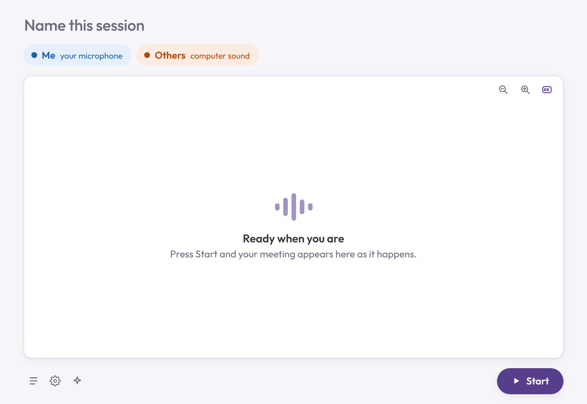

The light replaces a text status: green is ready, red is transcribing, yellow is paused.

### First run: get the model
SprkNotes needs a transcription model before it can start. If none is installed, the empty window offers **Download model** and Start stays off until it is ready.

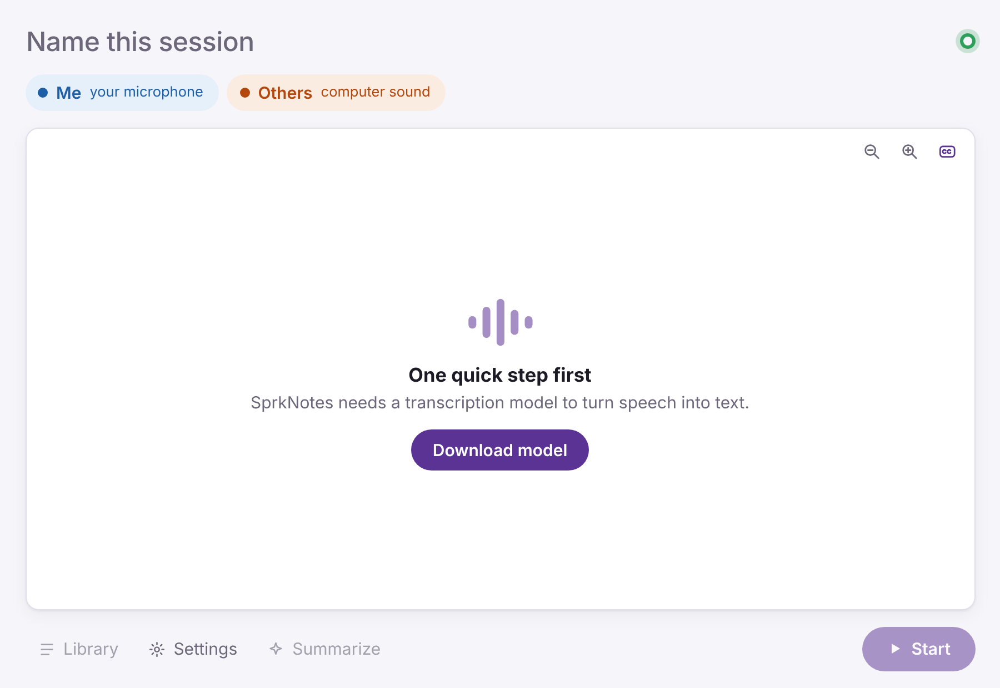

## While transcribing
- **Me (your microphone)** and **Others (computer sound)** switches turn each source on or off.
- **Pause** stops capture and writes a pause line. **Resume** continues. Timestamps keep counting, so the gap is visible.
- **End** finishes the file.
- The magnifier buttons change the text size. The **CC** button turns the live line on or off in this window.

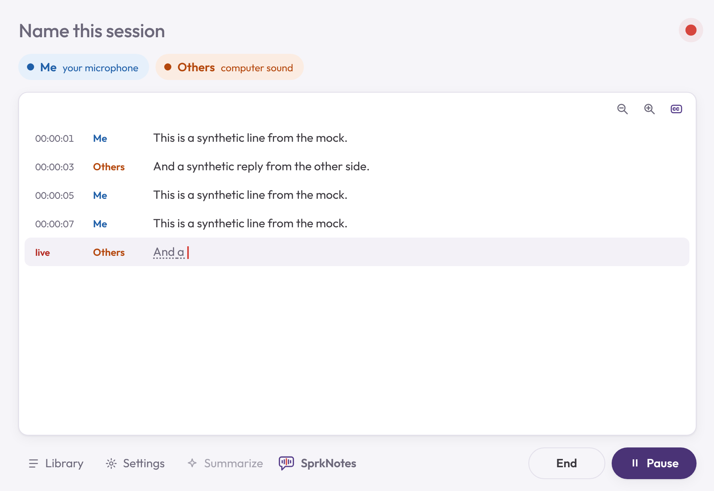
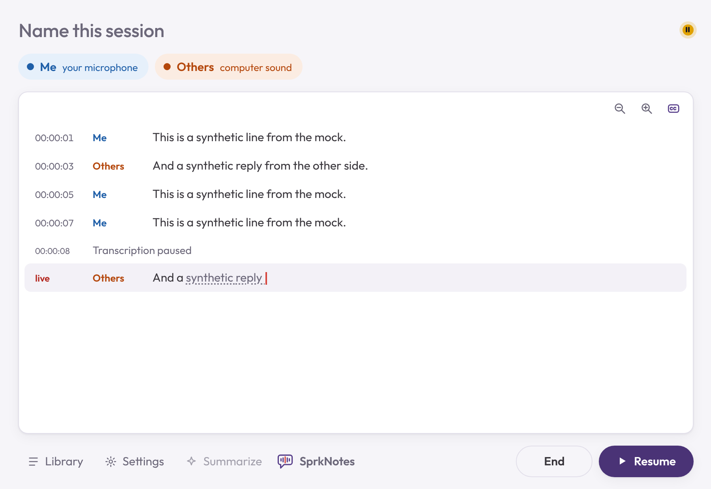

### The live line
The last row of the transcript, marked **live**, shows what is being said right now. Text types out at an even pace; only the last word or two are lighter and can still change. Sentences lock in as they finish (or after about 1.5 seconds, or a pause), stay in normal color, and are quietly replaced by the finished line later. The transcript fills from the bottom, so new rows push older ones up. The live line is a preview: it is never saved or logged, and the saved transcript comes only from finished sentences. By default it shows Others only (see [Settings](#settings)).

### Dark mode
Dark mode follows Windows or your desktop, or the choice in Settings.

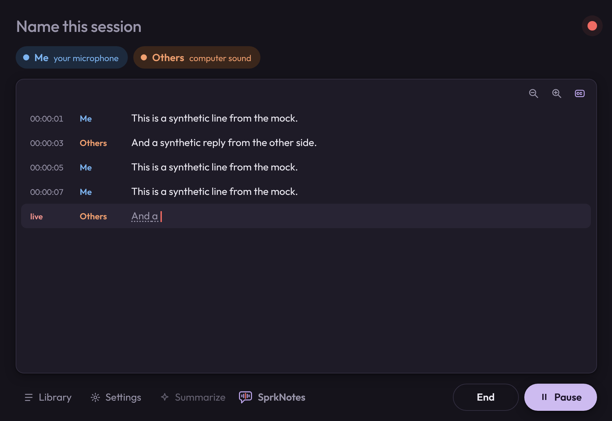

### Scrolling
The live pane follows new lines while you are near the bottom. Scroll up to read earlier text: it stops moving (it stops only when you scroll, never because text arrived), and a **Return to live** pill counts new lines. Click it or press **End** to jump back.

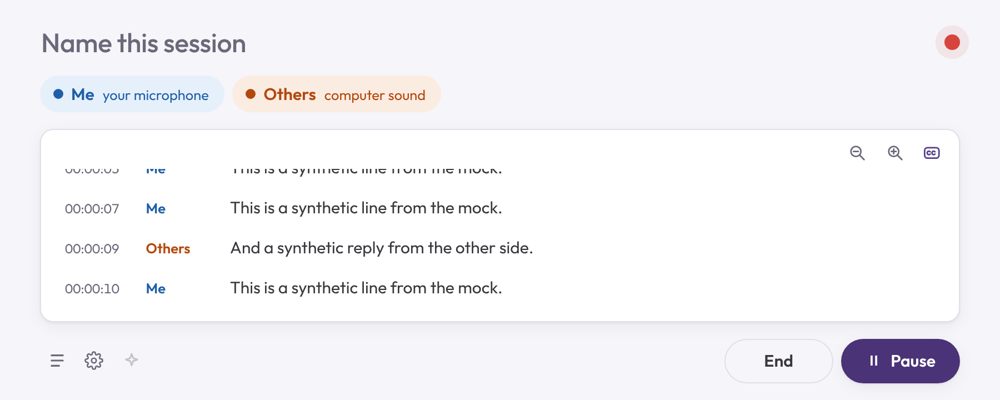

## The overlay
Minimize the window while a session is running (transcribing or paused) and a small overlay appears. It stays on top, and goes away when the main window returns. Without a session, nothing appears.

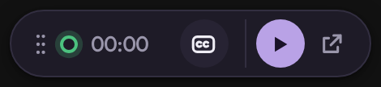

- **Drag** the dotted handle to move it. SprkNotes remembers where you left it on each screen.
- It always shows the light, the elapsed time and the captions button. Hover it (or tab to it) to reveal **Start or Pause or Resume**, **Stop** and **Open SprkNotes**.
- The overlay is dark by default. Choose Light in Settings to make it light.

### Live captions
Press the captions button to open a caption bar. It shows the newest lines with the line being spoken at the bottom. Others only by default; Settings can add Me.

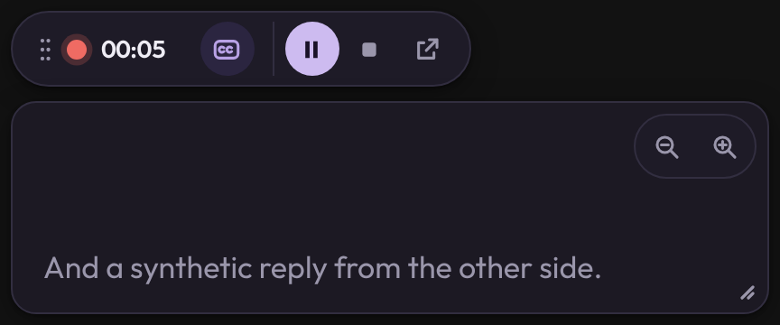

- Hover to show the text size buttons (magnifiers) and drag the corner handle (or use the arrow keys, Shift for fine steps) to resize. Size and text size are remembered.
- In the lower half of the screen the caption bar opens **above** the overlay so it is never off screen.

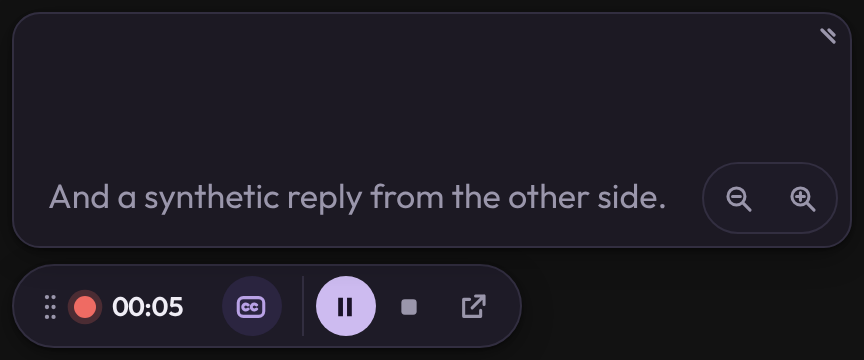
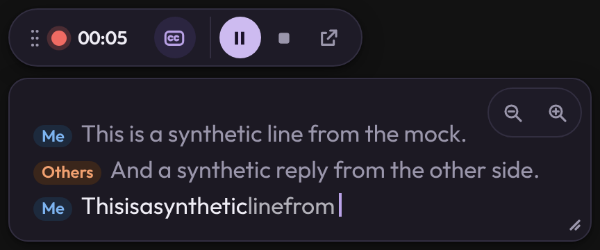

Captions are never saved, never logged and do not change the transcript. If the PC cannot keep up, captions switch themselves off for the session and transcribing carries on.

## The tray icon
The tray (notification area) icon mirrors the state: ready, transcribing or paused. Click it (or double-click on Windows) to bring the window back. Its menu has **Start**, **Pause**, **Resume**, **End**, **Open SprkNotes** and **Quit**, whichever apply.

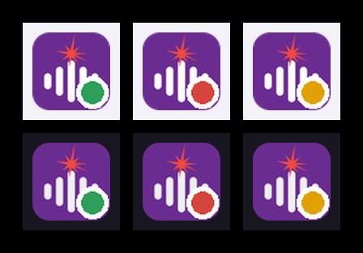

Closing the window with the X hides it to the tray and a running session carries on (if your desktop has no tray, Close minimizes instead). Use **Quit** in the tray menu to exit; it ends a running session first. Minimizing also shows the overlay while a session is running.

## Settings
Open **Settings** at the bottom of the window.

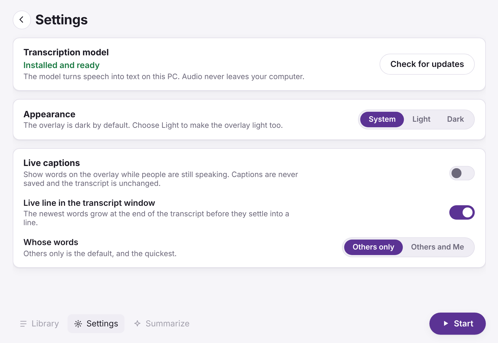

- **Transcription model.** Shows whether the model is installed. **Download model** fetches the current Parakeet model, and **Check for updates** looks for a newer one (SprkNotes also checks quietly when it starts and tells you). Downloads are in parts, checked before use, and blocked while a session is running. Your organization can turn downloads off or point them at an internal mirror, which shows in this panel.

  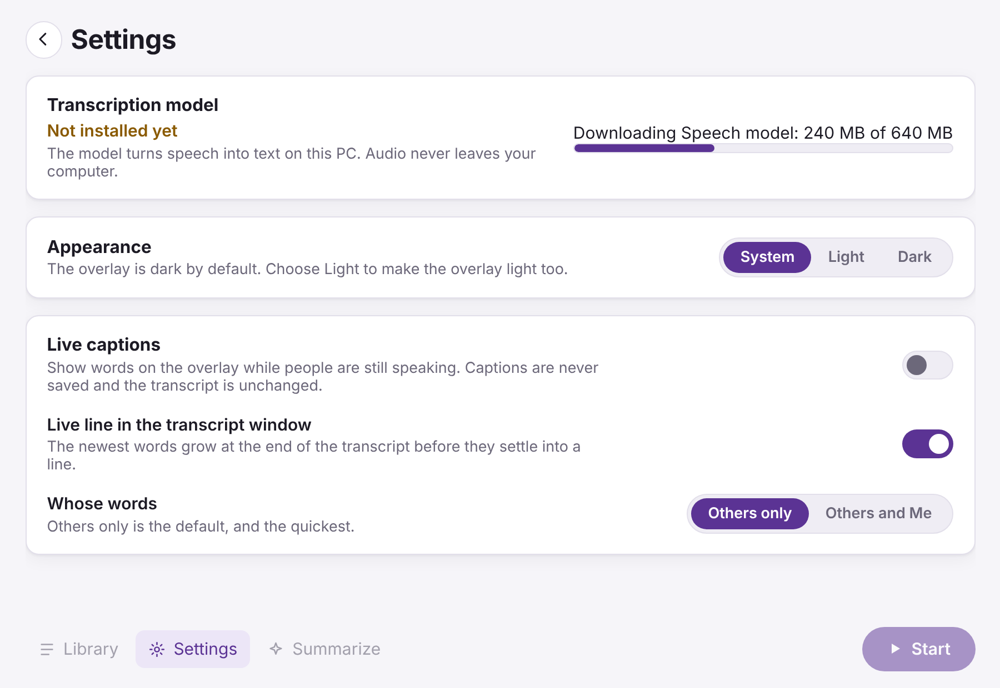
  
  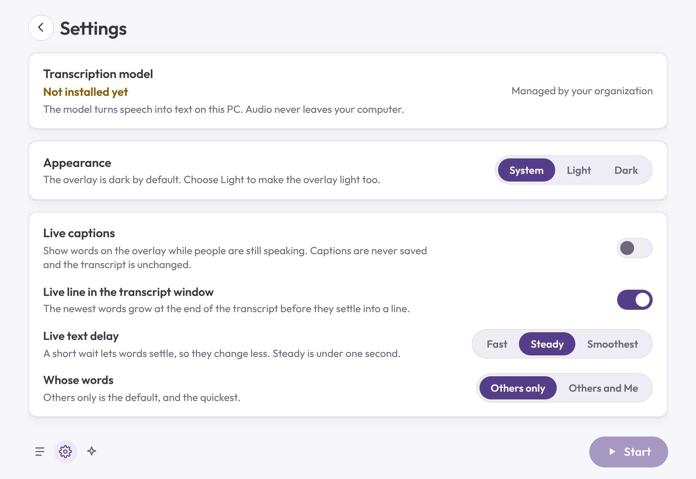
- **Custom words.** Names, medicines and product names you want spelled right, one word or phrase per line, then **Save**. When the speech model hears something close, such as "metaprolol" or "life spark", the transcript, the live line and captions show your spelling ("metoprolol", "Lifespark"). Only words of five or more letters are matched loosely, the first letter has to agree, and everyday words are never changed. Words your organization added are listed under the box. Changes apply from the next session, and a note says how many words the last session used.
- **Appearance.** System, Light or Dark.
- **Misc.** **Throwback Mode** (the first app icon). Everything else looks the same.

  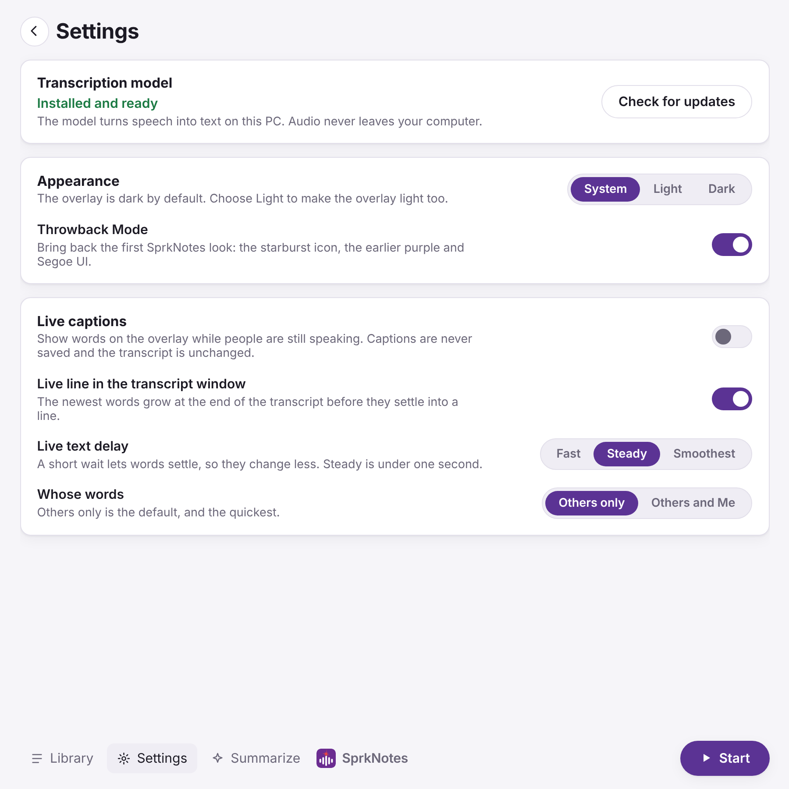
- **Live captions.** Turn captions on the overlay on or off, turn the live line in the main window on or off, set the **Live text delay** (Fast, Steady or Smoothest; a short wait so words settle and fewer change on screen, under a second on Steady), and choose **Others only** (default, quickest) or **Others and Me**.

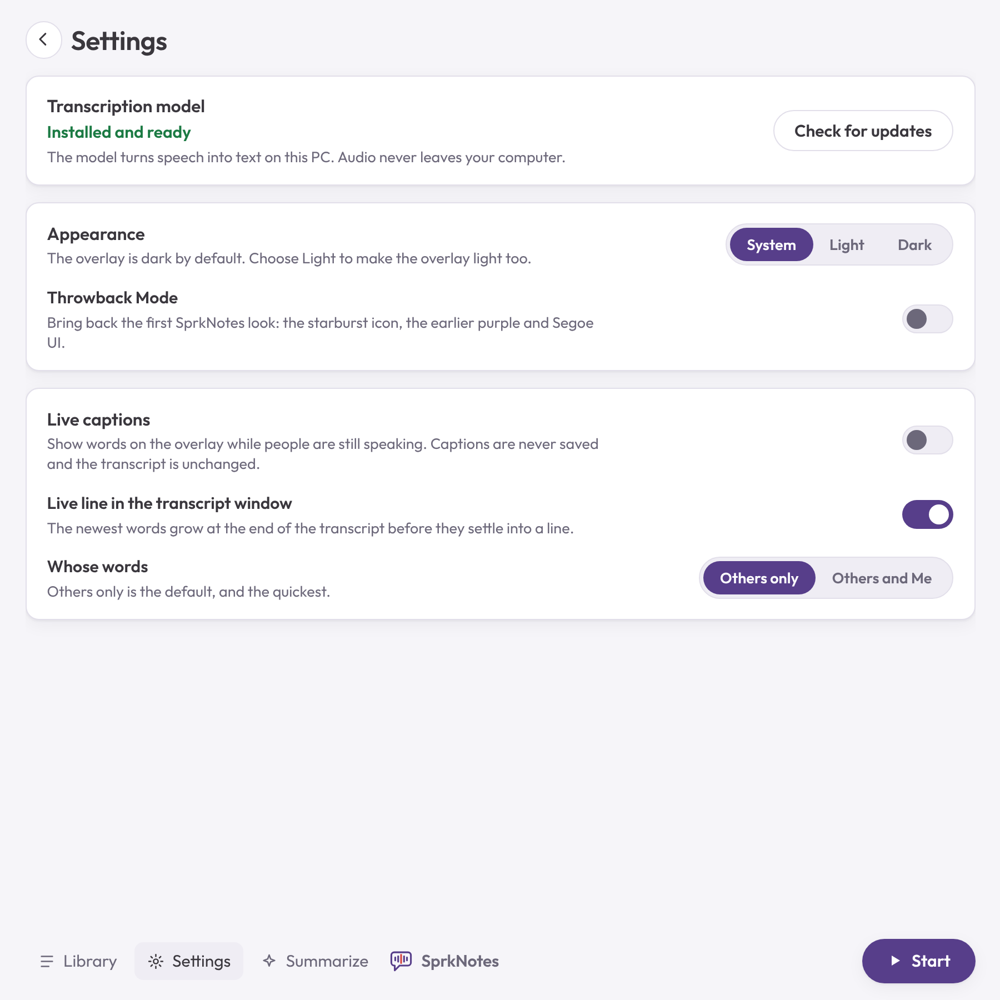

## Your files
Transcripts are Markdown files in `Documents\SprkNotes\Transcripts` (Windows), named `YYYY-MM-DD HHmm <Title>.md`. Each line is `- \`HH:MM:SS\` **Speaker:** text`. Lines starting with `>` are events (pauses, call changes, audio sources).

If the app or PC stops unexpectedly, the file already holds everything that was committed. On the next start SprkNotes says it closed unexpectedly and offers **Open** (takes you to the Library) or **Mark finished** (closes the transcript as interrupted).

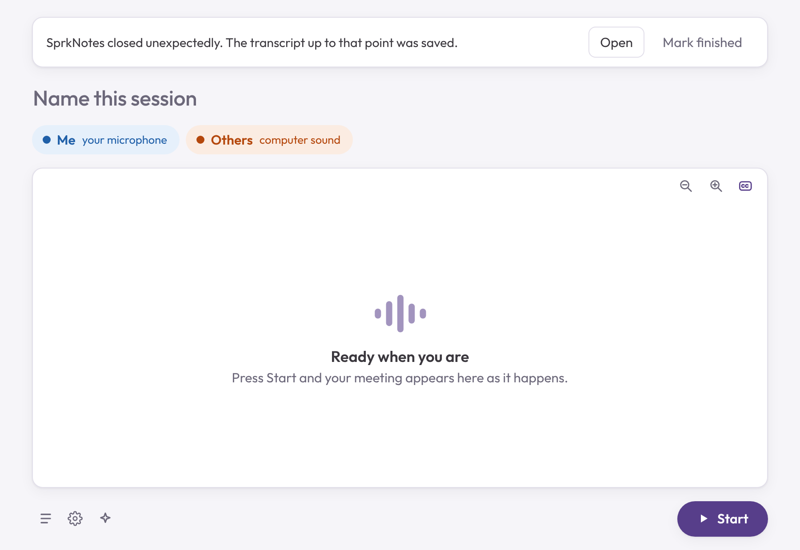

If something goes wrong during a session you see a notice instead of nothing: a Start that fails shows why; "A line could not be saved" means check that the transcripts folder can be written to and has free space; "The transcript could not be closed properly" means it still holds everything saved so far.

Lines are written in time order even when you and others talk at the same time, and long unbroken speech is committed steadily rather than all at once at the end.

Export to `.txt`, `.json` or `.docx` from the Library.

## Who is "Others"?
Everyone you hear through the speakers. On a confirmed 1:1 Teams call the other person is named. On group calls, or when nobody can be identified, it stays `Others`. Speech from a video or other app playing sound is shown as an audio source event; it may not be a person in the meeting. Live captions and the live line always say `Others`.

## Library
**Library** (bottom bar) lists your transcripts, newest first. Type in the search box to match names and the words inside transcripts. Open one to read it, then use **View in folder**, **Export** (Word document, plain text or JSON, saved next to the transcript), **Move**, **Rename**, **Delete** or **Summarize**. It reads the same folder transcripts are saved to; no setup needed.

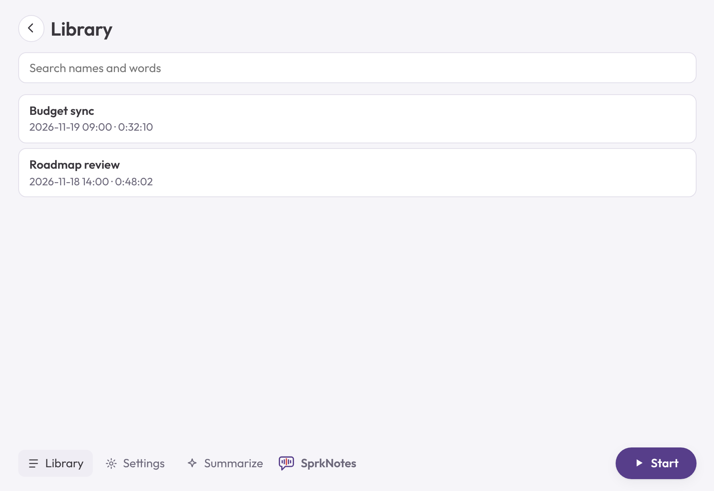
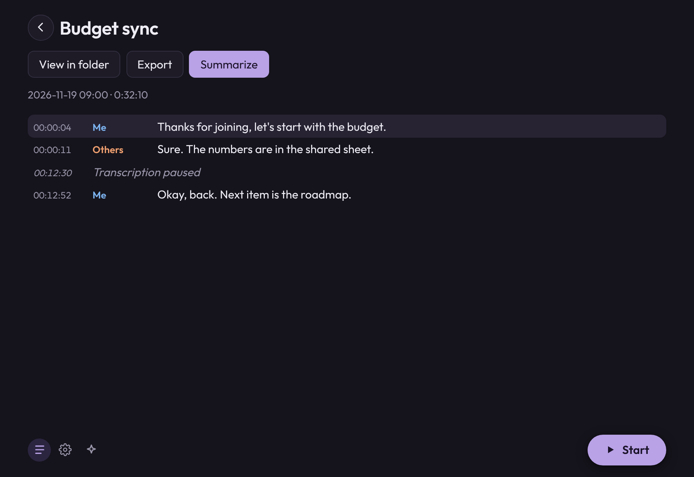

**Folders.** Pick a folder above the list to see only its transcripts (and its subfolders'), or All transcripts. **New folder** makes one inside the folder you picked; **Rename folder** renames it. To put a transcript in a folder, open it and use **Move**. Dragging is not in yet.

**Rename** changes the name shown in the Library and the file name; the date and time at the start of the file name stay. **Delete** asks first, then moves the transcript to the Recycle Bin, where you can restore it. Summaries and exports saved next to it are not deleted. While a session is running, its transcript (and the folder it is in) can't be renamed, moved or deleted until you press End.

## Summarize with Claude or Copilot
**Summarize** (bottom bar, after a session ends, or inside an open transcript) hands the transcript to an assistant. SprkNotes sends nothing itself: you review and send inside that app.
- If only one of the Claude or Microsoft 365 Copilot desktop apps is installed, it opens that one (Claude gets the file; for Copilot the prompt is copied and the file highlighted).
- If both are installed, it asks which.

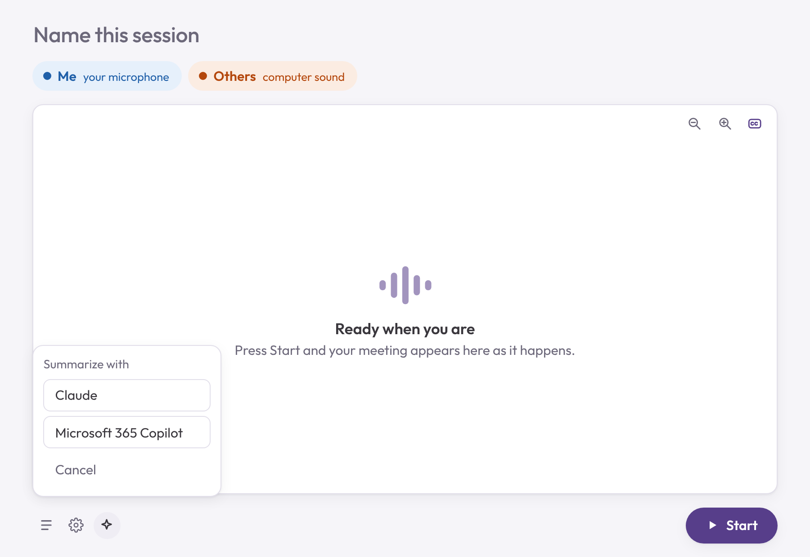
- If neither is found, it copies the prompt and shows the file, so you can attach it wherever you like.

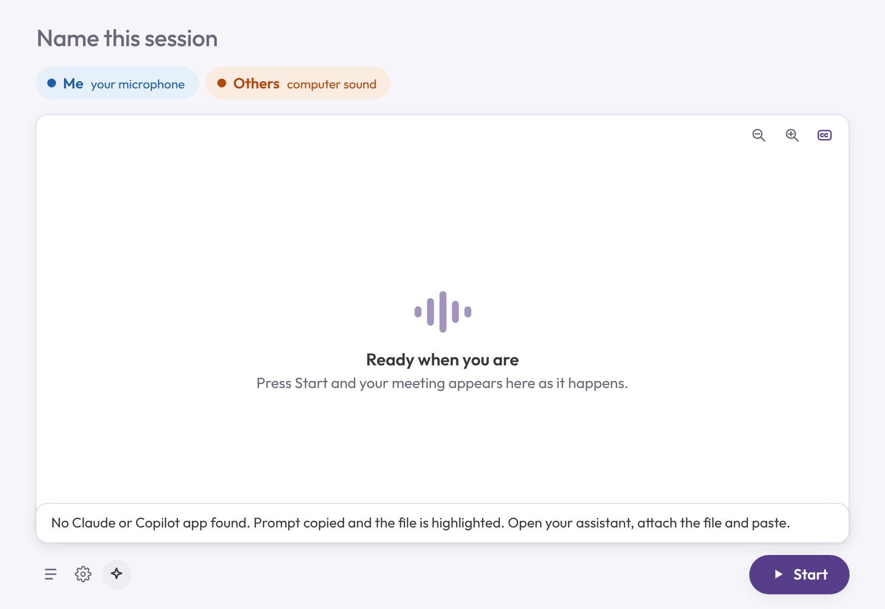

## On Linux
Same app and windows, with these differences:
- **Others** is the default output's monitor source, read through PipeWire or PulseAudio (`parec` must be installed).
- The overlay runs through XWayland on Wayland desktops so it can be moved and stay on top. Set `SPRKNOTES_WAYLAND=1` to opt out.
- The tray icon needs a tray host (libayatana-appindicator, or KDE's own). Without one the app still works; there is just no tray icon. Tray hosts built on libayatana-appindicator send no click events, so use the tray menu's **Open SprkNotes**.
- `packaging/linux/install.sh` adds SprkNotes to your app menu (see [install.md](install.md#d-linux-native-build)).
- Transcripts go under your Documents folder and models under `$XDG_DATA_HOME/SprkNotes` (or `~/.local/share`).

## Privacy
Audio never touches the disk and nothing is sent anywhere by SprkNotes, apart from downloading transcription models when you ask (or the quiet check for a newer one at launch). Transcripts contain what was said; treat them like any other sensitive document.
