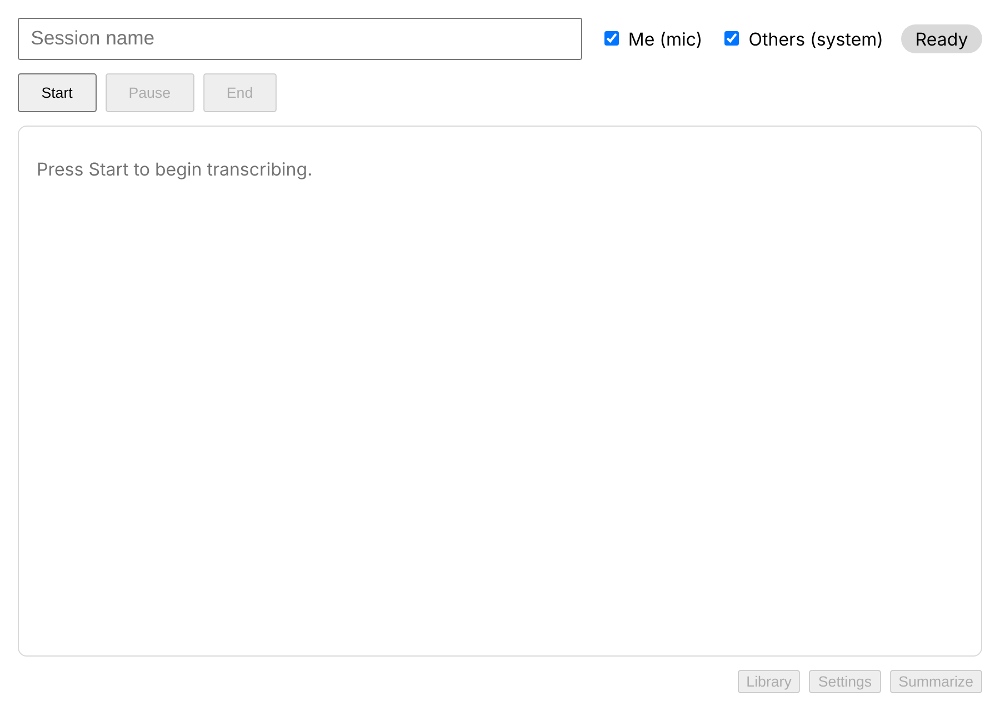
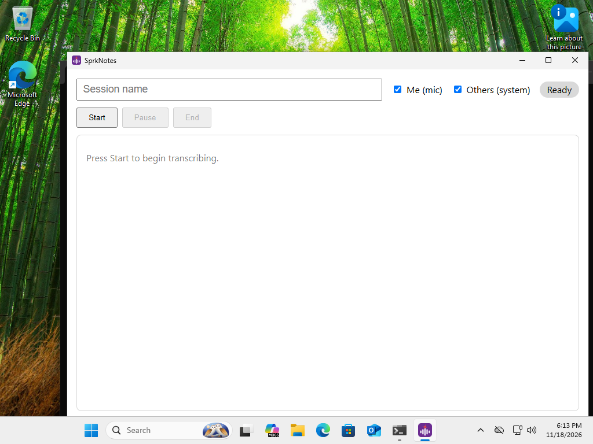
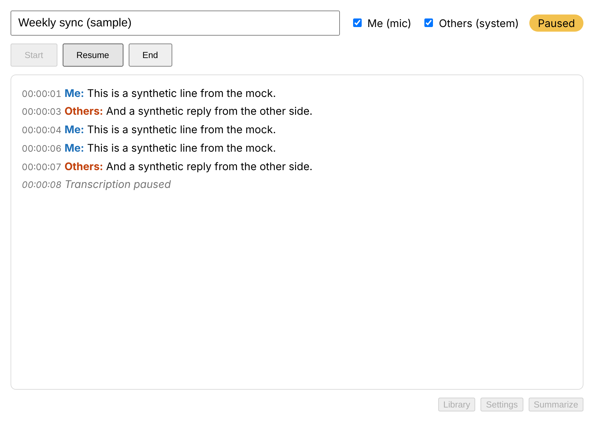
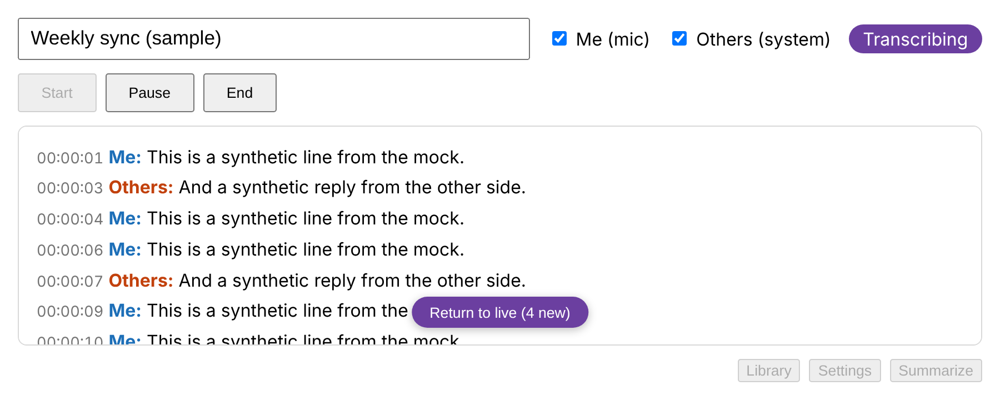

# SprkNotes user guide

## Start a session
1. Open SprkNotes. The status pill says **Ready**.
2. Optionally type a session name. If you leave it blank, SprkNotes names the file from your calendar, the call, or the audio playing, and falls back to `Transcript`.
3. Press **Start**. The pill says **Transcribing**.

The same window running on Windows 11 (empty state, no transcript data):

## While transcribing
- **Me (mic)** and **Others (system)** toggles turn each source on or off.
- **Pause** stops capture and writes a pause line. **Resume** continues. Timestamps keep counting, so the gap is visible.
- **End** finishes the file.

Dark mode follows Windows:

### Scrolling
The live pane follows new lines while you are near the bottom. Scroll up to read earlier text: it stops moving, and a **Return to live** pill counts new lines. Click it or press **End** to jump back.

## Your files
Transcripts are Markdown files in `Documents\SprkNotes\Transcripts`, named `YYYY-MM-DD HHmm <Title>.md`. Each line is `- \`HH:MM:SS\` **Speaker:** text`. Lines starting with `>` are events (pauses, call changes, audio sources).

If the app or PC stops unexpectedly, the file already holds everything that was committed. On the next start SprkNotes offers to mark it as interrupted.

Export from the library to `.txt`, `.json` or `.docx`.

## Who is "Others"?
Everyone you hear through the speakers. On a confirmed 1:1 Teams call the other person is named. On group calls, or when nobody can be identified, it stays `Others`. Speech from a video or other app playing sound is shown as an audio source event; it may not be a person in the meeting.

## Summarize with Claude or Copilot
After a session, **Summarize** opens Claude (file attached) or copies the prompt for Microsoft 365 Copilot and highlights the file. SprkNotes sends nothing: you review and send inside that app.

## Privacy
Audio never touches the disk and nothing is sent anywhere by SprkNotes. Transcripts contain what was said; treat them like any other sensitive document.
